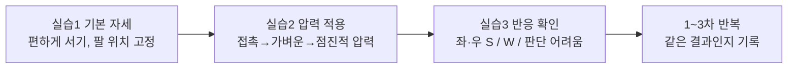
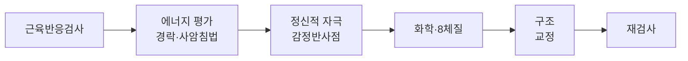

## 1. 강의 개요

1강의 목표는 "강한 힘"이 아니라 "같은 조건에서 반복 가능한 근육반응검사"의 기본기를 세우는 것입니다.

| 항목 | 내용 |
| --- | --- |
| 교육과정 | AK 자연치유요법 12주 과정 |
| 회차 | 제1강 (90분) |
| 주제 | 근육반응검사의 원리와 기본 검사법 |
| 강사 / 기관 | 비공개 (개인 학습용 정리) |
| 자료 | 학생용 원고 6쪽, 녹취 약 37분, 사암침법 혈위 카드 |
| 보충 자료 | 강의 뒤에 받은 『살림손길(Touch for Health)』, 『사암침법의 이해와 활용』. 책과 다른 곳은 **책을 기준**으로 삼고 나란히 적었으며 **[보충]** 표시와 쪽수를 붙였습니다 |

**학습목표:** AK 근육반응검사의 기본 개념, 일정한 방법의 Strong/Weak 검사, 검사자의 자세와 힘의 방향, 검사 오류의 구분, 전체 검사 흐름.

## 2. AK란 무엇인가 — 4대 영역

AK(Applied Kinesiology, 응용근신경학)는 근육 반응을 관찰해 몸의 기능적 상태를 평가하는 방법이며, 이 과정은 근육반응검사를 바탕으로 네 영역을 다룹니다.

| 순서 | 영역 | 살펴보는 것 | 이 과정의 특징 |
| --- | --- | --- | --- |
| ① | 에너지(Energy) | 경락과 관련된 반응 | 사암침법 혈위 카드와 연결 |
| ② | 정신(Mind) | 정서·정신적 자극에 따른 근육반응 변화 | 감정반사점 |
| ③ | 화학(Chemistry) | 음식·영양·체질 관련 반응 | **8체질과 연계**한 근육반응검사가 중심 |
| ④ | 구조(Structure) | 근육·관절·척추·골반 | 척추·골반 교정 등 구조적 접근 |

암기: **에너지 → 정신 → 화학 → 구조**.

- **표준 AK와의 차이:** AK 창시자의 표준 틀은 "건강의 삼각형(구조·화학·정신)"입니다. 이 과정은 에너지(경락)를 독립 영역으로 앞세우고, 표준 AK에 없는 8체질의학과 사암침법을 결합한 한국식 변형 커리큘럼입니다.
- **[보충] 책이 말하는 근육검사의 자리 (『살림손길』 6쪽):** 책은 AK 안에서도 근육검사가 통상의 검사와 함께 보는 **추가 실마리일 뿐, 그 자체로 진단의 수단이 되지는 못했다**고 적습니다. 원고의 "근육반응검사는 의학적 진단을 대신하지 않는다"와 같은 입장입니다.

## 3. 근육반응검사의 원리 — 5대 원칙과 Strong/Weak

핵심 공식은 **자세 + 방향 + 압력 + 반복성**입니다.

**5대 원칙 (원고):** ① 정확한 자세(관절 위치 일정) ② 일정한 힘(서서히 올림) ③ 일정한 방향 ④ 검사자의 안정된 자세 ⑤ 필요하면 같은 조건에서 좌우 비교.

| 구분 | 원고 정의 | 강의에서 말한 손의 느낌 |
| --- | --- | --- |
| Strong (S) | 압력을 가해도 자세를 비교적 안정적으로 유지 | 압력을 조금씩 올려도 "짱짱하게" 버팀 |
| Weak (W) | 같은 조건에서 자세를 못 유지하거나 반응이 뚜렷이 감소 | 일정한 압력을 계속 주면 **점점** 내려감, 버티는 지점에서 미세하게 흔들림·떨림 |

- Weak은 "내가 세게 눌러서" 떨어지는 것이 아니라, 일정한 압력에서 버티지 못하고 서서히 내려가는 것입니다. 순간이 아니라 몇 초간의 변화를 봅니다(00:00–05:30). 시연 근육은 삼각근.
- 원고 경고: **Strong ≠ 건강, Weak ≠ 질병.**

**[보충] 압력·시간·거리의 기준 — "2의 법칙" (『살림손길』 21쪽, 42쪽)**

| 기준 | 책의 수치 | 뜻 |
| --- | --- | --- |
| 압력 | 2파운드(약 1kg) **이하** | 그 이상은 필요 없다. 약 60g만 줘도 두 사람 모두 잠김과 풀림을 느낄 수 있다고 함 |
| 시간 | 약 **2초** 안에 눌렀다가 푼다 | 2초를 넘기면 그 근육이 피로해져 힘이 빠질 수 있다 |
| 거리 | 2인치(약 5cm) | 팔이 5cm 안에서 잠기지 않으면 풀린 것(Weak)으로 본다 |

- 책은 Strong/Weak 대신 **잠김(lock)/풀림(unlock)**이라는 말을 권합니다. "버텨라·저항해라"는 말은 피검사자가 다른 근육을 끌어다 쓰게 만들기 때문입니다(23쪽).
- **강의와 다른 점:** 강의는 "몇 초간 변화를 본다", "실제로는 세게 누른다"고 했고 책은 **가볍게(1kg 이하), 2초 안에** 끝내라고 합니다. 참고 도서를 기준으로 삼는 원칙에 따라 **연습 기본값은 책의 수치**로 두시기를 권합니다. 강사의 방식이 왜 다른지는 확인 사항입니다.
- 피검사자든 검사자든 **통증이 있으면 멈춥니다**(21쪽).

**[보충] 지표근육과 전삼각근 자세 (『살림손길』 17쪽, 41–42쪽):** 지표근육은 정상 기능하는 근육이면 무엇이든 될 수 있는 **기준 근육**입니다. 전삼각근 자세는 팔을 곧게 펴 **몸 앞쪽으로 약 30°** 들고, 검사자가 **손목 부근의 아래팔**을 아래로 누릅니다. 본 검사 전에 지표근육이 제대로 잠기는지부터 확인합니다(2강 3장의 Switch On → 지표근육 확인 순서가 여기서 왔습니다).

## 4. 실습 절차와 강의 시연 포인트

실습은 "기본 자세 → 압력 적용 → 반응 확인" 3단계이며, 원고의 실습 기록지(1·2·3차 좌우 기록, 반복성 체크)를 그대로 씁니다.

**혼자 연습하는 법 (02:30–08:00)**

- 자기 손가락으로 하는 자가검사로 연습합니다. "힘 빼라" 신호와 "힘 줘라" 신호를 정해 두고, 각각에서 떨어짐과 버팀이 분명히 구분되는지 확인합니다.
- 강의 설명: 신호는 "설정하기 나름"이며, 같은 동작도 "힘 줘라"로 설정하면 강해진다. 고수는 신호를 정한 뒤 **다 잊고** 검사한다. 결과를 예상하고 하면 안 된다. 이것이 확실해지면 "80%는 된 것".

**검사 횟수와 헷갈릴 때**

- 1·2·3차는 바로 이어서 해도 되지만, 피곤하거나 집중이 안 될 때는 하지 않는 것이 낫습니다. 처음에는 한 사람을 두고 결과가 일정하게 나올 때까지 반복합니다(19:55–21:10).
- 결과가 애매하면 물 한 잔 마시고 다시 합니다(13:15–16:20). **[보충]** 수분 검사의 동작(뒤통수 머리카락 당기기)과 Switch On은 2강 3장에 정리했습니다. 염분 검사 동작은 책에 없어 확인이 필요합니다.
- **[보충] 보상 (『살림손길』 23쪽):** 검사가 잘 안 되면 피검사자가 "이기려는" 자세를 쓰고 있는지 봅니다. 팔꿈치 굽힘, 몸통 돌림, 주먹 꽉 쥠, 숨 멈춤이 신호입니다.

## 5. 검사에서 자주 발생하는 오류

| 검사자의 오류 | 피검사자의 오류 |
| --- | --- |
| 너무 강하게 누른다 | 검사 전에 지나치게 힘을 준다 |
| 갑자기 힘을 준다 | 몸 전체를 이용해 버틴다 |
| 매번 다른 방향으로 누른다 | 검사 자세가 계속 변한다 |
| 검사자의 자세가 흔들린다 | 검사 방법을 이해하지 못한 채 실시한다 |
| **결과를 예상하고 검사한다** | |

- 강의가 덧붙인 변수: 검사자가 피곤하면 상대가 강하게 느껴질 수 있다(12:30). 의심하는 피검사자는 세게 눌러야 정확하다고 했다(06:04). 힘주는 "척"만 하는 피검사자도 있다(12:17).
- **[보충] 버티는 사람을 대하는 법은 책과 강의가 반대입니다 (『살림손길』 22–23쪽).** 책은 힘이 세거나 경직된 사람에게 **오히려 더 약한 압력**을 쓰고, 먼저 "힘겨루기가 아니라 함께 살펴보는 것"임을 설명하라고 합니다. 참고 도서 기준으로는 **압력을 사람에 따라 올리지 않는 쪽**이 맞고, 원고의 원칙 ②와도 이쪽이 일치합니다.
- "결과를 예상하고 검사한다"는 오류는 8장에서 다시 다룹니다. 이 과정 전체에서 가장 중요한 오류입니다.

## 6. 전체 검사 흐름, 8체질 연결, 사암침법 카드

**8체질 검사 단계 (원고 9장):** 사상체질 관련 경혈 → 8체질 관련 경혈 → 모혈 → 감정반사점 → 대리검사. 일반 8체질의학은 맥진으로 판별하지만 이 과정은 근육반응검사를 반복해 판별합니다. 절차는 2강에 있습니다.

- 강의의 예(24:00–26:00): 위의 모혈에서 근육이 떨어지면 토음체질로 본다. 토음은 위가 가장 강한 체질이지만 "강한 것"과 "항진"은 다르다.

**사암침법 Sedation(승격) 카드 읽는 법 (27:00–31:15)**

| 장부 | 보(補) | 사(瀉) |
| --- | --- | --- |
| 위 (시연 예) | 임읍↓, 함곡↓ | 상양↑, 여태↑ |

- 화살표 = 자극 방향. 기준 자세는 **두 팔을 머리 위로 든 자세**이며, 음경은 위로, 양경은 아래로 흐릅니다. 흐름 방향으로 자극하면 보, 반대 방향이면 사입니다.
- 이 과정은 침 대신 **레이저침**으로 자극합니다. 카드는 외우지 않고 보면서 쓰라고 했습니다.
- **[보충] 책으로 확인 (『사암침법의 이해와 활용』 60–62쪽·255쪽, 『살림손길』 30쪽·56쪽):** 위승격은 책 부록과 일치합니다(보 함곡·임읍, 사 여태·상양). 실한 경맥의 기운을 덜어내는 처방이 승격, 허한 경맥에 더해 주는 처방이 정격입니다. 경락의 방향도 책과 같습니다. 『살림손길』은 이 혈들을 **손가락으로 20~30초 가볍게 눌러** 씁니다. 오수혈 표와 그림, 정격·승격 그림은 2강 4장에 있습니다.

## 7. 원고에 없던 강의 내용

| 시각 | 내용 |
| --- | --- |
| 07:50–09:50 | 근육검사로 테이핑 방향까지 정한다. 붙일 방향·당길 방향을 검사로 찾아 한 장만 붙인다. |
| 14:15–15:50 | 물 컵을 쥐고 "물을 보충하라"고 말하면 근육이 강해지는 시연. "말의 힘"이라는 설명. |
| 17:20–19:50 | 8체질의 장점 주장: 성격, 아플 곳 예측, 운동 종목·포지션 적성, 마라톤 기록 한계까지 알 수 있다. |
| 21:20–22:35 | 근육검사는 형태로 나타나기 전 단계도 잡을 수 있지만, 질병을 단정하면 오해와 충돌이 생기니 절제하라. |
| 24:30–24:50 | 예/아니오 질문으로 검사하는 방식 시연 ("암이 있습니까" → 경락별로 위치 찾기). |
| 26:00–27:30 | 스트레스 검사 후 해결책을 예/아니오로 고르는 시연: 정신요법·차크라·음악·수면 → 모두 아니고 사암침법 → 위 경락 실증 → 사법. |
| 33:10–36:30 | 준비물: 레이저침, 테이핑, 액티베이터(교정기). 강도 조절이 되는 액티베이터를 권함. 제조사 이름은 녹취가 불분명. |

녹취는 자동 음성인식이라 용어 오인식이 있었고 문맥과 카드로 보정했습니다(사음침법→사암침법, 이목→임읍, 한곡→함곡, 상향→상양, 연분→염분).

## 8. 비판적 검토 — 근거 수준과 주의점 {: .critical }

결론부터: 1강의 **검사 자세·압력·방향을 표준화하라는 기술 원칙은 타당**하지만, 근육반응으로 체질·질병·해결책을 "읽어낸다"는 부분은 이중맹검 연구에서 우연 수준을 넘지 못했습니다. 이 장은 특정 개인이 아니라 방법의 근거 수준을 평가합니다.

**1. 강의 안에 이미 답이 있습니다.** 강의에서는 신호를 "설정하기 나름"이라 했고, 스트레스 검사에서 설정을 뒤집자("스트레스가 있으면 세진다") 결과도 뒤집혔습니다. 결과가 설정을 따른다면, 그 검사는 몸보다 검사자·피검사자의 기대를 측정하고 있을 가능성이 큽니다. 이것이 관념운동효과(ideomotor effect)이고, 원고가 "결과를 예상하고 검사한다"를 오류로 꼽는 이유이기도 합니다.

**2. 맹검 연구 결과.** 독성 용액과 식염수 병을 무작위로 쥐게 한 2014년 이중맹검 연구(51명)에서 AK 검사자의 적중률은 53%로 우연 수준이었습니다 ([PubMed](https://pubmed.ncbi.nlm.nih.gov/24607076/), [결과 요약](https://www.fundacaobial.com/media/3394/44_a-study-to-assess-the-validity-of-applied_bolsa167-06_03012014.pdf)). 1988년 영양상태 검사 연구에서는 숙련 검사자 3명끼리도 결과가 일치하지 않았습니다 ([PubMed](https://pubmed.ncbi.nlm.nih.gov/3372923/)).

**3. 구체적으로 조심할 대목**

- 의심하는 사람은 더 세게 누른다: 압력이 사람마다 달라지면 원칙 ②③을 스스로 깨는 셈입니다.
- 물 컵 시연: 검사자와 피검사자가 모두 무엇을 쥐었는지 아는 상태의 시연이라 기대 효과를 배제할 수 없습니다.
- "암이 있습니까" 예/아니오 검사: 원고의 "근육반응검사 결과만으로 질병을 진단하지 않는다"와 정면으로 충돌합니다. 현장에서는 "없다"는 결과가 병원 방문을 늦추게 할 수 있어 가장 위험한 사용법입니다.
- 8체질의 운동 포지션·마라톤 한계 판별: 이를 뒷받침하는 연구는 찾기 어렵습니다. 8체질의학 자체도 판별의 일치도가 논쟁 중인 분야입니다.

**4. 제안 — 스스로 확인해 보는 맹검 연습.** 같은 모양의 불투명 컵 두 개에 물/빈 컵(또는 소금물/맹물)을 다른 사람이 무작위로 넣고, 검사자와 피검사자 모두 모르는 상태에서 20회 검사해 적중률을 기록합니다. 몸이 정말 반응한다면 50%를 뚜렷이 넘어야 합니다.

**보충 자료를 보고 나서.** 참고 도서는 검사 기본기(압력, 시간, 자세, 수분 검사)를 바로잡는 기준으로 썼습니다. 그러나 책과 일치한다는 것은 "배운 대로 정확히 옮겼다"는 뜻이지 **방법이 실제로 맞는다는 증거는 아닙니다.** 위 1~3번의 평가는 그대로입니다.

- 책 스스로 한계를 적어 둔 대목: AK에서도 근육검사는 "그 자체로 진단의 수단이 되지 못했다", 근육이 풀렸다고 "장기에 손상이 있다는 뜻은 아니다"(『살림손길』 6쪽, 31쪽). 강의의 "암이 있습니까" 식 검사는 이 과정이 뿌리를 둔 책의 입장에서도 벗어납니다.
- 책은 근육검사를 "에너지 변화를 반영하는 지표"로, 물 마시기를 "물이 주는 정보를 인체에 전달하는 것"으로 설명합니다. 측정할 수 없는 기전이라는 점에서 1번의 문제는 책의 방식에도 똑같이 적용됩니다.
- 실용적으로 얻을 것은 있습니다. **1kg 이하, 2초** 기준은 "세게 눌러서 떨어뜨리는" 오류를 줄여 줍니다. 다만 압력이 가벼울수록 검사자의 손이 무의식적으로 결과를 만들 여지는 커지므로, 4번의 맹검 연습이 더 중요해집니다.

**현장 활용 관점:** 접촉과 대화의 출발점, 테이핑·스트레칭 같은 구조적 도움은 그대로 가치가 있습니다. 다만 결과를 "진단"이 아니라 "몸의 반응을 함께 살펴보는 경험"으로 설명하고, 질병 여부는 반드시 의료기관으로 연결하는 선을 지키시길 권합니다.

## 9. 꼭 기억할 5가지 · 확인할 것

**오늘의 핵심 한 문장:** "좋은 근육반응검사의 출발점은 강한 힘이 아니라 정확하고 반복 가능한 검사이다."

**꼭 기억할 5가지**

1. 근육반응검사는 단순한 힘겨루기가 아니다.
2. 검사 자세와 힘의 방향을 일정하게 유지한다.
3. 갑자기 강한 힘을 주지 않는다.
4. 한 번의 결과보다 반복되는 반응을 중요하게 본다.
5. 근육반응검사 결과만으로 질병을 진단하지 않는다.

**확인문제 요점:** AK = Applied Kinesiology. 4대 영역은 에너지 → 정신 → 화학 → 구조. 일정하게 유지할 것은 자세·방향·압력·검사자 자세·좌우 조건. Strong/Weak의 뜻은 3장 표. 반복 검사가 중요한 이유는 한 번의 반응이 압력·방향·컨디션·기대에 쉽게 흔들리기 때문.

**강사께 확인할 것:** (1) 책은 1kg 이하로 2초 안에 검사하라는데 강의에서는 세게, 몇 초간 본다고 한 이유 (2) 염분 검사 동작 (3) 액티베이터 제조사.
