## 1. 강의 개요

2강은 1강에서 익힌 근육반응검사를 **8체질 판별**에 적용하는 회차입니다. 새로 외울 것은 **12경맥 오수혈(60개)**이고, 이것으로 만든 검사 단계를 순서대로 실습합니다.

| 항목 | 내용 |
| --- | --- |
| 교육과정 | AK 자연치유요법 12주 과정 |
| 회차 | 제2강 |
| 주제 | AK 근육반응검사를 이용한 8체질 판별 |
| 강사 / 기관 | 비공개 (개인 학습용 정리) |
| 자료 | 학생용 교재 사진 5장(오수혈표, 1차·2차 검사표와 그림, 모혈표, 체크리스트, 복습문제), 녹취 약 66분 |
| 보충 자료 | 강의 뒤에 받은 「체질별 장부의 특징」(유인물), 『사암침법의 이해와 활용』, 『살림손길(Touch for Health)』. 노트와 자료가 다를 때는 **자료를 기준**으로 고쳤고 **[보충]** 표시와 쪽수를 붙였습니다. 책의 사진·그림은 저작권이 있어 싣지 않았습니다 |

**학습목표 (교재):** Switch On과 지표근육(IM)의 의미, 오수혈과 체질별 보·사 검사의 연결, 1차(금·목·토·수)와 2차(8체질) 검사의 구분, 모혈과 추가 검사로 반복·교차 확인. 교재 첫 쪽에 "교육용 체질 판별 절차이며 질병의 의학적 진단을 대신하지 않는다"는 문구가 있습니다.

녹취는 자동 음성인식이라 오인식이 많아(접형골, 사암침법, 모혈, 중완, 소상 등) 교재와 문맥으로 보정했고, 확인되지 않는 부분은 "불분명"으로 표시했습니다.

## 2. 전체 흐름

교재의 순서는 다음과 같습니다. 강사는 이를 "1차 → 2차 → 모혈(3차) → 감정반사점 → 대리검사"로 설명했고, 중간에 결과가 어긋나면 처음으로 돌아갑니다.

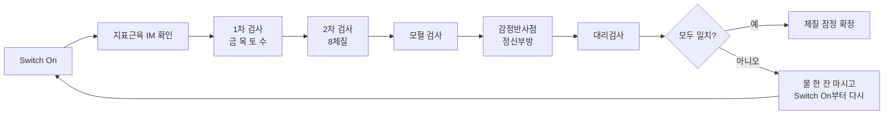

## 3. Switch On과 지표근육(IM)

교재: 검사 전에 피검사자의 반응 상태와 에너지 균형을 점검하고, 강하면서 기능적으로 문제가 없는 근육을 지표근육으로 정해 Strong/Weak 반응의 일관성을 확인합니다. 교육에서는 전삼각근을 주로 씁니다.

- **Switch On**은 상하·좌우·앞뒤의 균형을 맞추는 준비 동작이며, **검사자도 똑같이 해야** 합니다(06:03–08:30). 지표근육은 전삼각근이 가장 하기 편해 많이 쓰고, 빠르게 해야 하는 치료사는 손가락 근육을 씁니다.
- 헷갈릴 때는 물 한 잔 마시고 다시 합니다.

**[보충] Switch On의 동작 (『살림손길』 37쪽, 45쪽):** 세 가지 모두 **한 손은 배꼽 위에** 두고, 다른 손으로 ① **쇄골 아래, 복장뼈와 만나는 오목한 두 지점**(수부혈) ② **윗입술 위(수구혈)와 아랫입술 아래(승장혈)** ③ **꼬리뼈 아래(장강혈)**를 차례로 문지르고, 손을 바꿔 반복합니다. 어느 동작이 어느 방향(상하·좌우·앞뒤)인지는 책에 없습니다. 필요한지 미리 보려면 세 곳에 손을 댄 채 지표근육을 검사해 꺼지는 곳만 문지릅니다(45쪽).

**[보충] 수분 검사 (『살림손길』 46쪽):** 지표근육이 잘 잠기는지 확인한 뒤, **뒤통수의 머리카락을 한 움큼 잡아당긴 채로** 다시 검사합니다(팔의 털이나 피부를 집어도 됨). 꺼지면 수분 부족으로 보고 **피검사자와 검사자 모두** 물을 조금 마신 뒤 다시 합니다. 염분 검사 동작은 책에 없어 확인이 필요합니다.

## 4. 12경맥 오수혈

오수혈은 각 경맥마다 **정(井)·형(滎)·수(輸)·경(經)·합(合)** 다섯 혈로, **팔꿈치와 무릎 아래**에만 있습니다. 12경맥 × 5 = 60개이므로 순서만 외우면 됩니다.

> **쉬운 설명:** 60개를 규칙 없이 외우기 어렵다면 [오수혈 이름의 뜻과 순서의 규칙](02-osuhyeol.html)을 먼저 읽어 보세요. 물길 비유, 자리의 규칙, 이름에 반복되는 글자, 장부·오행·육기·삼음삼양까지 따로 정리했습니다.

| 경맥 | 정 | 형 | 수 | 경 | 합 |
| --- | --- | --- | --- | --- | --- |
| 수태음폐경 | 소상 | 어제 | 태연 | 경거 | 척택 |
| 수양명대장경 | 상양 | 이간 | 삼간 | 양계 | 곡지 |
| 족양명위경 | 여태 | 내정 | 함곡 | 해계 | 족삼리 |
| 족태음비경 | 은백 | 대도 | 태백 | 상구 | 음릉천 |
| 수소음심경 | 소충 | 소부 | 신문 | 영도 | 소해 |
| 수태양소장경 | 소택 | 전곡 | 후계 | 양곡 | 소해 |
| 족태양방광경 | 지음 | 족통곡 | 속골 | 곤륜 | 위중 |
| 족소음신경 | 용천 | 연곡 | 태계 | 복류 | 음곡 |
| 수궐음심포경 | 중충 | 노궁 | 대릉 | 간사 | 곡택 |
| 수소양삼초경 | 관충 | 액문 | 중저 | 지구 | 천정 |
| 족소양담경 | 족규음 | 협계 | 족임읍 | 양보 | 양릉천 |
| 족궐음간경 | 대돈 | 행간 | 태충 | 중봉 | 곡천 |

- **소해가 두 곳:** 심경의 소해(少海)와 소장경의 소해(小海)는 이름만 같습니다. **[보충]** 책은 심경 쪽을 **음소해**(팔꿈치 안쪽 주름 끝), 소장경 쪽을 **양소해**(팔꿈치 뒤쪽, 주두 옆 새끼손가락 쪽 홈)라 부릅니다(52–53쪽, 245–246쪽).
- 암기는 "소상, 어제, 태연, 경거, 척택"처럼 박자로 읊으며 짚고, 위치는 **스티커 붙이기**로 익힙니다(09:26–11:05).
- 책의 표기 차이: 족통곡=통곡, 족임읍=임읍, 족규음=규음, 복류=부류. 같은 혈입니다.

**[보충] 오수혈의 오행 — "폐木(소상)" 같은 표기를 읽는 법 (『사암침법의 이해와 활용』 51–59쪽)**

5장·6장 검사표의 "폐木", "간金", "비水", "신土"의 뒤 글자는 **그 혈에 배당된 오행**이며, 배당 순서가 음경맥과 양경맥에서 다릅니다.

| | 정 | 형 | 수 | 경 | 합 |
| --- | --- | --- | --- | --- | --- |
| 음경맥 (폐·심포·심·비·간·신) | 木 | 火 | 土 | 金 | 水 |
| 양경맥 (대장·삼초·소장·위·담·방광) | 金 | 水 | 木 | 火 | 土 |

| | 손(수) | 발(족) |
| --- | --- | --- |
| 음경맥 | 수음경: 폐·심포·심 | 족음경: 비·간·신 |
| 양경맥 | 수양경: 대장·삼초·소장 | 족양경: 위·담·방광 |

- 음경맥은 정→형→수→경→합에 **木→火→土→金→水**(木은 봄, 기운의 시작), 양경맥은 **金→水→木→火→土**를 잇습니다(책 51·54·55쪽). 한 경맥 안 다섯 혈의 순서이지 장부 순서가 아닙니다. 예: 폐경은 소상=木, 어제=火, 태연=土, 경거=金, 척택=水. 교재 검사표의 표기는 이 배당과 모두 일치합니다.
- **[개인 의견]** 양경이 금에서 시작하는 이유는 책에 없습니다. 음경이 봄(木)에서 시작하니 양경은 반대격인 가을(金)에서 시작했다는 것은 이 노트를 쓰는 사람의 해석이며 근거로 인용하지 마세요.

**[보충] 정격과 승격 (『사암침법의 이해와 활용』 60–62쪽, 『살림손길』 56쪽)**

- "허하면 그 어머니를 보하고, 실하면 그 아들을 사한다." 허한 경맥에 **더해 주는** 처방이 정격, 실한 경맥에서 **덜어내는** 처방이 승격입니다. 한 처방은 혈 4개(보 2 + 사 2)로, 자기 경맥의 혈과 다른 경맥의 혈을 함께 씁니다. 예: 폐정격은 태연(폐 土)·태백(비 土) 보, 어제(폐 火)·소부(심 火) 사.
- 12경맥의 정격·승격과 보사 방향은 책 부록 2(253–264쪽)에 사진으로 있습니다. 『살림손길』은 이 혈들을 **손가락으로 20~30초** 눌러 쓰고 "사암손길혈"이라 부릅니다.

**정격·승격 자리와 방향 한눈에 보기**

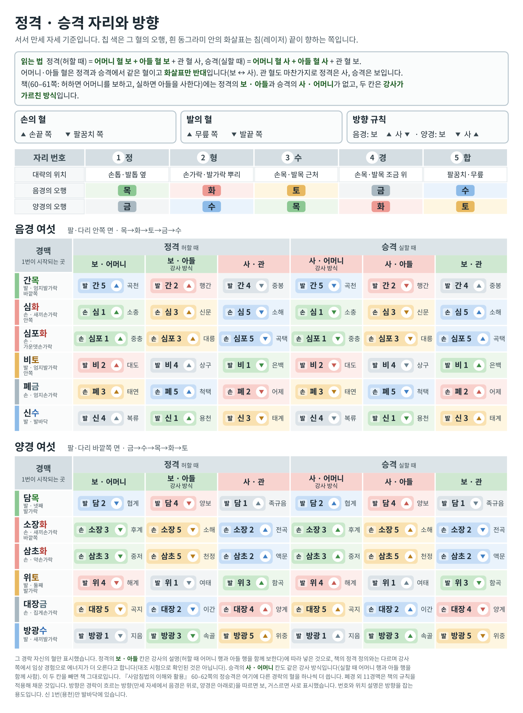

휴대폰에서는 [그림만 따로 열기](../assets/img/02-jeongseung.svg)를 눌러 손가락으로 확대해 보면 편합니다.

> **주의:** 이 그림은 책의 규칙(허하면 어머니 보 + 관 사, 실하면 관 보 + 아들 사)에 **강사가 가르친 방식 두 칸**(정격의 보·아들, 승격의 사·어머니)을 더한 것입니다. 이 두 칸은 책에 없고 강사의 임상 경험에 근거하며, 대조 시험으로 확인된 것이 아닙니다. 그림에는 그 경락 자신의 혈만 있고 책은 여기에 다른 경락의 혈을 하나씩 더 씁니다. 폐경 외 11경맥은 책의 규칙을 적용해 채운 것이고 책 부록 2 사진과는 대조하지 않았습니다.

**경맥 이름과 장부 (14:40–19:30)**

| 오행 | 장(藏, 찬 것) | 부(府, 빈 것) |
| --- | --- | --- |
| 목(木) | 간 | 담 |
| 화(火) | 심 · 심포 | 소장 · 삼초 |
| 토(土) | 비 | 위 |
| 금(金) | 폐 | 대장 |
| 수(水) | 신(콩팥) | 방광 |

- 짝이 되는 장과 부의 관계를 **표리 관계**라고 합니다. 삼초는 형태가 없는 부, 심포는 심장을 싸는 막입니다(장부의 역할은 쉬운 설명 6장).
- **음양과 방향:** 음경은 아래에서 위로, 양경은 위에서 아래로 흐릅니다(26:44–27:35). 1강의 기준 자세(두 팔을 머리 위로 든 자세)와 같은 말입니다.

**경맥별 오수혈 한눈에 보기**

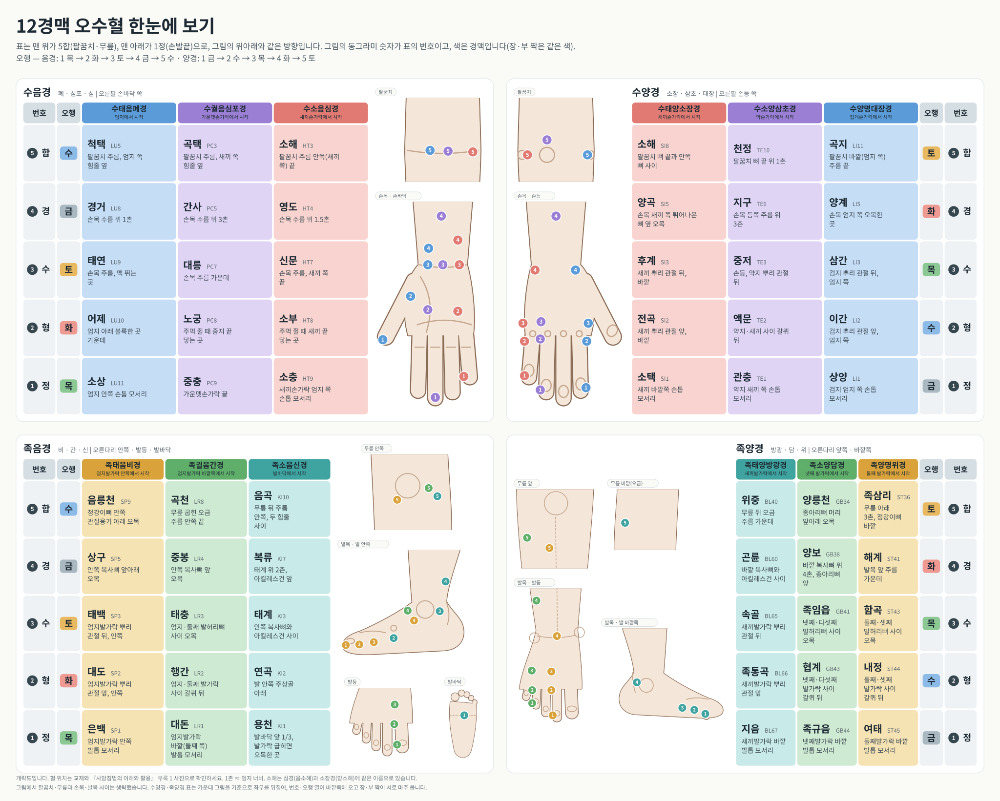

휴대폰에서는 [그림만 따로 열기](../assets/img/02-5shu-all.svg)를 눌러 손가락으로 확대해 보면 편합니다.

## 5. 1차 검사 — 금·목·토·수 체질군

1차는 사상체질에 해당하는 **네 체질군**을 가르는 단계입니다. 강사는 금=태양인, 목=태음인, 토=소양인, 수=소음인으로 대응시켰습니다(24:39–25:02).

| 체질군 | 보(補) | 사(瀉) |
| --- | --- | --- |
| 금체질 | 폐木(소상) 보 | 간金(중봉) 사 |
| 목체질 | 폐木(소상) 사 | 간金(중봉) 보 |
| 토체질 | 비水(음릉천) 보 | 신土(태계) 사 |
| 수체질 | 비水(음릉천) 사 | 신土(태계) 보 |

교재: 각 조합을 적용한 뒤 동일한 지표근육으로 반응을 비교하며, **한 번의 반응으로 확정하지 않습니다.**

- **보와 사 (24:39–27:35):** 보는 경락이 흐르는 방향으로, 사는 반대 방향으로 자극합니다. 침은 교재 그림의 화살표 방향대로 놓습니다.
- **강사의 단순화 "사상체질혈" (28:44–29:23):** 강사는 보·사를 모두 쓰면 헷갈리므로 개인적으로 **보만** 씁니다. 소상 보에서 세지면 금, 중봉 보면 목, 음릉천 보면 토, 태계 보면 수. 이 용어는 강사가 붙인 이름입니다.
- **검사하는 법 (27:52–31:07):** 근육이 "세진다"는 것은 **세진다고 미리 설정해 두어야** 합니다. 마음속으로 "1차 합니다"라고 말하고 검사하며, 한 번에 **한 가지에서만** 세진다고 했습니다. 강사의 "내 개념이 확실하면 환자에게 정보가 전달되어 몸이 반응한다"는 설명은 9장에서 검토합니다.

## 6. 2차 검사 — 8체질

1차에서 체질군이 나오면 **양체질인지 음체질인지**만 구분하면 됩니다(31:37–32:26).

**금·목 체질 (교재 A4-5)** — 신장경 혈을 씁니다.

| 체질 | 보·사 ① | 보·사 ② (표) | 보·사 ② (그림) |
| --- | --- | --- | --- |
| 금양체질 | 신土(태계) 사 | 신水(음곡) 보 | 신木(용천) 보 |
| 금음체질 | 신金(복류) 사 | 신火(연곡) 보 | 신火(연곡) 보 |
| 목양체질 | 신土(태계) 보 | 신水(음곡) 사 | 신木(용천) 사 |
| 목음체질 | 신金(복류) 보 | 신火(연곡) 사 | 신火(연곡) 사 |

**교재 내부 불일치:** 금양과 목양의 ②번이 표에는 음곡(水), 같은 쪽 그림에는 용천(木)입니다. **강사께 확인이 필요합니다.** 받은 참고 자료 3건에는 8체질 2차 검사표가 없어 풀리지 않았습니다. 불일치가 없는 여섯 체질의 두 혈은 모두 "뒤의 것이 앞의 것을 누르는 상극 쌍"(金·火, 火·水, 土·木)이고, 같은 규칙이면 ①번 土(태계)를 누르는 ②번은 木(용천)이 됩니다. **표의 규칙으로만 보면 그림의 용천 쪽이 일관되지만 이것은 제 추론**이며, 확인 전까지는 미확정입니다.

**토·수 체질 (교재 A4-6)** — 폐경 혈을 씁니다.

| 체질 | 보·사 ① | 보·사 ② |
| --- | --- | --- |
| 토양체질 | 폐火(어제) 사 | 폐水(척택) 보 |
| 토음체질 | 폐土(태연) 사 | 폐木(소상) 보 |
| 수양체질 | 폐火(어제) 보 | 폐水(척택) 사 |
| 수음체질 | 폐土(태연) 보 | 폐木(소상) 사 |

**표의 규칙:** 금과 목, 토와 수는 같은 혈에서 보와 사만 뒤집힙니다(금양↔목양, 금음↔목음, 토양↔수양, 토음↔수음). 1차 표도 같은 구조입니다.

**검사하는 법 (32:59–37:50)**

- 8가지 중 한 가지에서만 힘이 세진다고 했습니다. **한 혈씩** 자극하며, 강사는 이 단계도 보만 씁니다. 표에서 보만 뽑으면 금음=연곡, 목양=태계, 목음=복류, 토양=척택, 토음=소상, 수양=어제, 수음=태연, 금양=음곡(표) 또는 용천(그림)입니다(제가 표에서 뽑은 것).
- 레이저침은 혈 하나에 **약 10초**, 없으면 손으로 자극해도 됩니다.
- **어디서 검사하나:** 자극을 준 뒤 **인당(양 눈썹 사이)에 손을 대고** "이것이 효과가 있습니까"라고 묻는 방식으로 지표근육을 검사합니다(36:21–37:14).
- **일치 조건:** 1차에서 수체질이 나왔다면 2차에서는 수양이나 수음만 나와야 합니다. 이어지지 않으면 1차가 잘못된 것입니다.

## 7. 모혈 · 감정반사점 · 정신부방 · 대리검사

**모혈 검사 (교재 A4-7)** — 3차에 해당합니다.

| 체질 | 경락 | 모혈 | 위치 (『살림손길』 235쪽 기준) |
| --- | --- | --- | --- |
| 금양 | 폐경 | 중부 | 어깨뼈 부리돌기(쇄골 바깥 끝 아래에 만져지는 뼈) 조금 아래. 양쪽 |
| 금음 | 대장경 | 천추 | 배꼽에서 빗장중간선까지의 가운데(배꼽 옆 2촌). 양쪽 |
| 목양 | 간경 | 기문 | 젖꼭지 아래로 6번과 7번 갈비뼈 사이. 양쪽 |
| 목음 | 담경 | 일월 | 젖꼭지 아래로 7번과 8번 갈비뼈 사이. 양쪽 |
| 토양 | 비경 | 장문 | 11번 갈비뼈의 끝(몸의 옆면). 양쪽 |
| 토음 | 위경 | 중완 | 명치 끝과 배꼽의 중간(배꼽 위 4촌). 가운데 한 곳 |
| 수양 | 신경 | 경문 | 12번 갈비뼈의 끝. 양쪽. 책은 **등 쪽 그림**에 표시 |
| 수음 | 방광경 | 중극 | 배꼽에서 치골 맨 위까지의 4/5 지점(배꼽 아래 4촌). 가운데 한 곳 |

- **방향 주의:** 1차·2차는 "힘이 **세지는** 쪽"이 답이고, 모혈은 손을 댔을 때 **근육이 떨어지는 쪽**이 답입니다(40:48–41:31). 강사는 해당 체질의 경락이 가장 "항진"된다고 설명했습니다.
- **[보충] 모혈 검사의 원래 쓰임 (『살림손길』 234쪽):** 책에서도 방향은 같습니다. 모혈에 **가볍게 접촉한 채로** 지표근육을 검사해 약해지면 그 경락의 에너지 과잉으로 보고, 양쪽에 있는 모혈은 양쪽을, 한 번에 하나씩 검사합니다. 책에서는 체질 판별이 아니라 경락의 과잉 여부를 보는 검사이며, 이 과정은 그것을 "가장 강한 장부의 경락을 찾는" 용도로 가져다 쓴 것입니다.

**[보충] 체질별 장부의 강약 순서 (유인물 「체질별 장부의 특징」)**

| 체질 | 가장 강함 → 가장 약함 |
| --- | --- |
| 금양 | 폐(대장) > 비(위) > 심(소장) > 신(방광) > 간(담) |
| 금음 | 대장(폐) > 방광(신) > 위(비) > 소장(심) > 담(간) |
| 목양 | 간(담) > 신(방광) > 심(소장) > 비(위) > 폐(대장) |
| 목음 | 담(간) > 소장(심) > 위(비) > 방광(신) > 대장(폐) |
| 토양 | 비(위) > 심(소장) > 간(담) > 폐(대장) > 신(방광) |
| 토음 | 위(비) > 대장(폐) > 소장(심) > 담(간) > 방광(신) |
| 수양 | 신(방광) > 폐(대장) > 간(담) > 심(소장) > 비(위) |
| 수음 | 방광(신) > 담(간) > 소장(심) > 대장(폐) > 위(비) |

- **모혈 표와 정확히 맞습니다.** 8체질 모두 모혈의 경락이 그 체질의 **가장 강한 장부**입니다. 양체질은 장(臟)이, 음체질은 부(腑)가 맨 앞에 옵니다. 짝 체질(금양·목양 등)은 순서가 정반대이고, 5·6장의 "보·사만 뒤집힌다"는 규칙과 같은 구조입니다.
- 유인물의 나머지(체질별 성격, 음식, 잘 걸리는 병)는 옮기지 않았고 9장에서 다룹니다.

**모혈 위치 그림** — 체질마다 모혈 1개만 표시한 앞면 개략도입니다. **[보충]** 『살림손길』 235쪽과 대조해 점의 자리는 그대로 두고 설명 문구만 책의 기준으로 고쳤습니다. 경문은 옆구리 뒤쪽에서 찾으세요.

### 금양체질 — 폐경 모혈 중부


### 금음체질 — 대장경 모혈 천추


### 목양체질 — 간경 모혈 기문


### 목음체질 — 담경 모혈 일월


### 토양체질 — 비경 모혈 장문


### 토음체질 — 위경 모혈 중완


### 수양체질 — 신경 모혈 경문


### 수음체질 — 방광경 모혈 중극


**감정반사점과 정신부방 (교재 A4-8, 41:31–45:23)**

1. 양쪽 눈썹 위 중앙의 **감정반사점**에 손을 대고 지표근육을 검사합니다. 약해지면 감정 쪽에 문제가 있다는 뜻입니다.
2. 약해졌다면 그 체질의 **정신부방** 혈을 자극한 뒤 다시 검사합니다.
3. 근육이 다시 강해지면 그 체질이 맞다고 보고, 효과가 없으면 체질 판별이 틀린 것으로 봅니다.

- **[보충] 감정반사점의 자리 (『살림손길』 38–39쪽):** 책의 "감정스트레스해소(ESR)"는 **이마융기**(눈썹과 머리카락 선 사이의 볼록한 두 지점)에 손을 댑니다. 교재의 "눈썹 위 중앙"과 같은 자리로 보입니다. 책에서는 혈을 자극하지 않고 **이마에 손을 대고 있는 것 자체**가 해소 방법이며, 정신부방은 나오지 않습니다.
- 정신부방으로는 관충과 중저를 많이 쓴다고 했습니다(42:17). **토양·토음의 정신부방 I·II는 3강 3장에 처방표로 있습니다.** 다른 여섯 체질은 아직 모릅니다.

**대리검사 (교재 A4-8, 45:26–47:19)**

- **대리검사 1(제3자):** 제3의 사람이 피검사자의 손목을 잡은 채로 검사합니다. **대리검사 2(검사자):** 검사자 자신의 몸에 1차·2차·모혈을 대고 검사합니다.
- **[보충] 책의 대리검사 (『살림손길』 256쪽):** 대리검사 1과 같은 방식입니다. 대리인이 피검사자의 팔이나 어깨에 접촉을 유지하고, 검사자는 대리인의 근육을 검사합니다. 시작 전에 **대리인 자신의 근육이 강한지 먼저 점검**하라는 순서는 강의에 없었습니다. 대리검사 2는 책에 없습니다.
- 다리를 모았다 벌리는 등 몸을 움직이면 "정보가 지워진다"고 했습니다(46:17).

**확정과 중단 (47:28–49:30):** 하나라도 어긋나면 물 한 잔 마시고 Switch On부터 다시, 그래도 헷갈리면 며칠 쉬었다가 다시 합니다. 강사는 8체질 한의원이 한 달쯤 걸려 확정하는 것을 이 방법은 5분 안에 열 가지를 검사해 빠르게 확정할 수 있다고 했고, 맥진은 "20만 명을 봐야" 정확해진다고 했습니다.

**실습 체크리스트 (교재 A4-9):** Switch On → IM Strong/Weak 확인 → 1차 체질군 검사 → 2차 8체질 검사 → 모혈 교차검사 → 감정반사점/정신부방 → 필요 시 대리검사 → 반복 결과 기록.

## 8. 원고에 없던 강의 내용

| 시각 | 내용 |
| --- | --- |
| 00:01–05:30 | 액티베이터로 접형골·경추 1번을 아주 약하게 교정한다는 설명(골반은 세게). 앞부분은 문맥이 불분명. |
| 07:22–07:35 | **사상체질에는 침법이 없고** 음식(또는 약)으로 치료하는 반면, 8체질에는 오수혈을 쓰는 침법이 있다. |
| 20:19–21:52 | 8체질 침은 유침하지 않고 바로 빼는 방식이라 잘못 놓아도 해가 거의 없다는 설명. 이 과정은 침 대신 레이저침. |
| 51:15–52:36 | AK 기본 교과서는 너무 어렵고, 강사는 자신의 방식이 효과가 더 좋다고 함. 에너지는 레이저침, 정신은 튜닝포크와 싱잉볼, 치료 우선순위는 경락으로 찾는다. |
| 55:49–56:11 | 국제 AK 협회가 사암침법을 자기네 테크닉처럼 쓰는 것이 아쉽다는 말. (확인하지 못함) |
| 56:17–57:05 | 사암침법의 **승격(실증)과 정격(허증)**. 보사는 8체질 침과 같다. "이 둘만 알면 침 고수가 될 수 있다." |
| 57:41–58:33 | 사암침법 카드에 오수혈표를 넣은 이유: 그림 없이 표만으로 혈을 찾게 하려는 것. |
| 59:50–01:00:46 | **액티베이터 매뉴얼**(골반부터 척추까지 전신 교정)이 따로 있다. "마사지로는 교정이 안 되고, 교정된 것처럼만 보인다"는 주장. |
| 01:02:40–01:04:06 | 문제의 종류를 에너지 → 정신 → 화학 → 구조 순으로 찾고 마지막에 "치료 충분"까지 검사한다. 에너지 문제의 해결책(레이저침, 8체질, 차크라, 에너지 젤, 홍삼, 근막 교정, 사암침법)도 하나씩 근육검사로 고른다. |

## 9. 비판적 검토 — 근거 수준과 주의점 {: .critical }

결론부터: 오수혈표를 외우는 일과 검사 순서를 표준화하는 일은 문제가 없습니다. 그러나 **"근육 반응으로 8체질을 판별한다"는 핵심 주장은 이번 강의에서도 검증 가능한 형태로 제시되지 않았고**, 1강에서 확인한 맹검 연구 결과가 그대로 적용됩니다. 이 장은 특정 개인이 아니라 **방법의 근거 수준**을 평가합니다. 새 출처는 이번에 따로 검색하지 않았고, 아래 근거는 1강에서 실제로 열어 본 두 건입니다.

**1. 결과가 "설정"에 좌우됩니다.** 강의에서는 "세진다고 설정해야 한다. 약하다고 설정하면 약한 게 맞는 반응"이라고 설명했습니다(27:52). 1강의 "신호는 설정하기 나름"과 같은 이야기입니다. 몸의 반응이 아니라 설정과 기대가 결과를 정한다면, 같은 근육 반응이 어떤 체질로도 읽힐 수 있습니다. 1강에서 인용한 맹검 연구(2014년, 51명, 적중률 53%, [PubMed](https://pubmed.ncbi.nlm.nih.gov/24607076/))와 숙련 검사자 3명의 결과가 일치하지 않았던 1988년 연구([PubMed](https://pubmed.ncbi.nlm.nih.gov/3372923/))는 이 의심을 뒷받침합니다.

**2. "정보 전달"은 확인할 수 없는 설명입니다.** "검사자의 개념이 확실하면 피검사자에게 정보가 전달된다"(30:06), "인당에서 정보를 주고받는다"(37:04), "다리를 움직이면 정보가 지워진다"(46:17)는 설명은 측정할 수 있는 기전이 아닙니다. 더 큰 문제는 구조입니다. 결과가 맞으면 체질이 확인된 것이고, 안 맞으면 "정보가 지워졌다, 컨디션이 안 좋다, 설정이 흐리다"로 설명할 수 있어서 **어떤 결과가 나와도 반박되지 않습니다.** 과학적으로 검증하려면 이 방법이 틀릴 수 있는 조건이 먼저 정해져야 합니다.

**3. 여러 검사가 일치해도 정확성의 증거가 되지 않습니다.** 열 가지 검사가 모두 일치하면 확정할 수 있다는 설명이 있었습니다. 하지만 1차에서 수체질이 나오면 2차는 수양/수음만 검사하고, 앞 결과를 알고 있는 검사자가 뒤 검사를 하면 **같은 기대가 끝까지 이어져** 일치하는 것이 당연합니다. 일치는 검사들이 서로 독립일 때에만 의미가 있습니다. 또 "두 개가 나오지는 않는다"(30:28)는 말은, 실제 측정이라면 노이즈로 둘이 나오거나 아무것도 안 나오는 경우가 생길 텐데 항상 하나로 정리된다는 뜻이라 검사자가 답을 하나로 수렴시키고 있을 가능성을 생각하게 합니다. (이 마지막 부분은 가능성의 지적이지 입증이 아닙니다.)

**4. 강의에서 제시된 수치와 주장은 출처를 확인하지 못했습니다.** "진맥은 20만 명을 봐야 하고, 논문상 7만 명 이상이면 70% 정확도"라는 설명, "국제 AK 협회가 사암침법을 자기 기법처럼 쓴다"는 설명은 이번에 확인하지 못했습니다. "마사지로는 교정이 안 되고 전용 기구로만 교정된다"는 주장도 비교 연구를 본 적이 없고, 강의에서도 근거가 제시되지 않았습니다.

**5. 기기 구입 전에는 이해관계를 확인하세요.** 레이저침 같은 기기는 효과 설명과 판매가 같은 자리에서 이루어지기 쉽습니다. 구입 전에 효과를 비교한 근거, 의료기기 인증 여부, 제품 등급, 눈 보호 안전수칙, 반품 조건을 확인하시는 것이 좋습니다.

**6. 안전·법적 주의 (제가 확인하지는 않은 일반적 주의입니다).** "8체질 침은 해가 거의 없다"는 설명은 강의 내용일 뿐 검증된 사실이 아닙니다. 침 시술은 한국에서 면허가 필요한 의료행위로 알려져 있어, **직접 침을 놓는 일은 법적 확인이 먼저 필요합니다.** 레이저침도 의료기기 분류가 될 수 있고, 해외에서는 현지 법이 다릅니다. 또 사상체질을 "음식으로 치료한다"는 설명(07:22)을 따라 체질 판별 결과로 **특정 음식을 금하거나 약을 권하면** 영양과 복약 문제가 생길 수 있어 가장 조심해야 합니다.

**7. 이 단계에서 합리적인 것은 무엇인가.** 오수혈 60개의 이름과 순서, 장부의 표리·오행 대응은 한의학 이론 틀을 배우는 암기 과제로서 중립적이고 표준 오수혈 체계와 일치합니다. 다만 이 틀이 "체질 판별로 건강을 설명한다"는 것을 증명하지는 않습니다. 검사 단계를 정해진 순서로 기록하며 반복하는 습관은 AK와 별개로 좋은 연습 방법입니다.

**8. 제안 — 스스로 해 볼 수 있는 맹검 확인.** 1강의 컵 실험을 이번 단계에 맞게 바꿔 볼 수 있습니다.

- **검사자 간 일치도:** 같은 피검사자를 서로 결과를 모르는 검사자 2~3명이 따로 판별해 기록합니다. 8체질이 우연으로 일치할 확률은 8분의 1(12.5%), 1차 네 체질군은 25%입니다. 몸의 반응을 읽는다면 이보다 뚜렷이 높아야 합니다.
- **자극 유무 맹검:** 도우미가 동전으로 "자극함/안 함"을 무작위로 정하고(20회), 검사자는 어느 쪽인지 모르는 채 인당에서 근육 강약만 기록해 적중률을 봅니다. 50%를 넘지 못한다면 결과는 검사자의 기대에서 나온 것일 가능성이 큽니다.
- 가까운 사람에게 연습할 때도 결과를 "진단"으로 말하지 않고 "함께 해 보는 연습"으로 설명하시기 바랍니다.

**보충 자료의 근거 수준.** 받은 참고 자료는 이 과정이 **어디에서 왔는지**를 보여 주는 원전이고, 이 노트의 혈 위치와 절차를 바로잡는 기준으로 썼습니다. 그러나 원전과 일치한다는 것은 "배운 대로 정확히 옮겼다"는 뜻이지, **방법이 실제로 맞는다는 증거는 아닙니다.** 위 1~3번의 평가는 그대로입니다.

- 『살림손길』은 근육검사를 "물리적인 힘을 재는 것이 아니라 에너지의 변화를 반영하는 지표"로 설명하고, 물을 마시면 "물이 주는 정보가 인체에 전달된다"고 씁니다. 강의의 "정보 전달" 설명과 같은 계열이며, 2번에서 짚은 문제가 그대로 적용됩니다. 대리검사도 같은 이유로 맹검 확인 없이는 판단할 수 없습니다.
- 유인물 「체질별 장부의 특징」에는 체질에 따라 특정 음식이 특정 질병(암, 심장병, 당뇨, 결핵, 간질환 등)을 만든다거나 장기의 크기가 다르다는 **단정적인 서술**이 많고, 출처나 연구는 제시되어 있지 않습니다. 장부의 강약 순서는 8체질 이론의 **정의**로서 7장에 옮겼지만, 음식·질병 서술은 6번의 "가장 조심해야 할 사용법"에 해당하므로 옮기지 않았습니다. 유인물의 음식·질병 내용을 근거로 **식단을 제한하거나 병의 원인을 설명해 주는 일은 권하지 않습니다.**
- 혈 위치는 사정이 다릅니다. 오수혈과 모혈의 자리는 책들끼리, 그리고 표준 경혈 위치와 서로 일치했습니다. "어디를 말하는가"는 믿을 만하게 정리되었고, 남은 질문은 "거기를 자극하면 무엇이 달라지는가"입니다.

**현장 활용 관점:** 접촉과 대화, 스트레칭·테이핑 같은 구조적 도움은 1강과 같은 선에서 의미가 있습니다. 8체질 판별 결과를 사람들에게 체질로 **통보하거나**, 체질에 따라 음식·약·침을 권하는 일은 이 근거 수준에서는 권하지 않습니다.

## 10. 꼭 기억할 5가지 · 확인할 것

**오늘의 핵심 한 문장:** "체질 판별은 한 번의 반응이 아니라 같은 결과가 여러 단계에서 반복되는지 보는 절차이며, 그 일치가 곧 정확성의 증거는 아니다."

**꼭 기억할 5가지**

1. 검사 전에 검사자와 피검사자 모두 Switch On을 하고, 지표근육의 Strong/Weak 일관성부터 확인한다.
2. 오수혈은 팔꿈치·무릎 아래의 정·형·수·경·합 다섯 혈이며, 12경맥 60개를 순서로 외운다.
3. 1차는 금·목·토·수 네 체질군, 2차는 양·음을 가르는 8체질이다. 1차와 2차는 서로 이어져야 한다.
4. 1차·2차는 힘이 세지는 쪽이 답이고, 모혈은 손을 댔을 때 약해지는 쪽이 답이다(방향이 반대).
5. 한 번의 반응으로 확정하지 않고, 어긋나면 물 한 잔 마시고 Switch On부터 다시 한다. 결과는 의학적 진단을 대신하지 않는다.

**복습문제 요점:** 1차 네 체질군의 보·사는 5장 표, 금양·금음의 2차 조합은 6장 표(금양 ②번은 확인 필요), 8체질별 모혈은 7장 표(모두 가장 강한 장부의 경락). 반복·교차검사가 필요한 이유는 한 번의 반응이 컨디션·수분·압력·기대에 흔들리기 때문이며, 같은 검사자가 앞 결과를 알고 이어서 하면 일치가 기대의 영향일 수 있어 실제 정확도는 맹검 확인이 필요하다.

**확인할 것:** (1) 금양·목양 2차 ②번 혈이 음곡인지 용천인지 (2) 토양·토음 외 여섯 체질의 정신부방 혈과 좌우 구분(토양·토음은 3강) (3) 염분 검사 동작 (4) 액티베이터 제조사.
