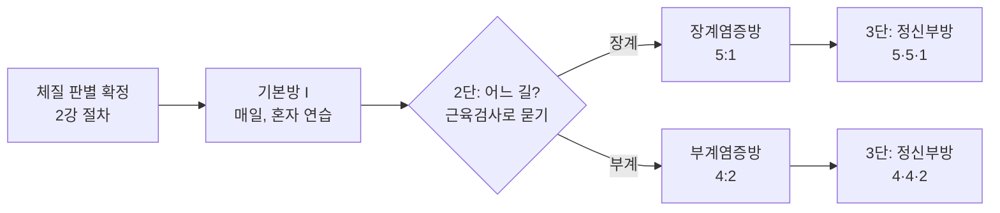

## 1. 강의 개요

3강은 2강의 체질 판별 결과를 이어받아, **토양체질과 토음체질**의 침법 처방(기본방 I·II, 부방 8종)을 처방표대로 읽고 자기 몸에 넣어 보는 회차입니다. 강의에서 예로 든 두 사람이 각각 토양·토음이어서 이 두 체질만 다루었고, 나머지 체질은 같은 원리로 뒤집어 읽습니다(3장).

| 항목 | 내용 |
| --- | --- |
| 교육과정 | AK 자연치유요법 12주 과정 |
| 회차 | 제3강 |
| 주제 | 토양체질과 토음체질의 침법 보사 체계 |
| 강사 / 기관 | 비공개 (개인 학습용 정리) |
| 자료 | 학생용 원고 4쪽(기본방 비교표, 부방 표 2개, 확인 항목), 녹취 약 71분 |

**학습목표 (원고)**

1. 토양의 기본방 I 신보와 기본방 II 방광보를 구분한다.
2. 토음의 기본방 I 비사와 기본방 II 위사를 구분한다.
3. 두 체질의 부방 여덟 종류를 원문과 대조한다.
4. 방 전체 이름과 개별 혈의 보·사 역할을 구분한다.
5. 체질명·방명·보혈·사혈·확인할 표기를 정확히 기록한다.

원고는 "2강에서 사용한 판별용 보·사 조합과 모혈을 침법의 기본방으로 자동 대체하지 않는다"고 못 박습니다. 판별은 판별이고, 처방은 **해당 체질의 처방표에서 따로 찾아 읽습니다.** 강의도 같은 말을 했습니다(28:12 "모혈·판별 혈자리와 침 넣는 것은 전혀 다른 문제").

**녹취 메모:** 자동 음성인식이라 오인식이 많습니다. 문맥과 원고로 보정한 것: 친법→침법, 적불균형→적불균형(適不均衡으로 추정, 강사 용어), 부류→복류(원고 표기는 부류), 상향→상양. 강의 중 예로 든 두 사람은 이 노트에서 "토양인 사람"·"토음인 사람"으로 씁니다. 녹음은 강의 도중(8체질 이론 설명)부터 시작되어 앞부분이 빠져 있습니다.

## 2. 전체 흐름 — 처방의 단계와 횟수

처방은 **기본방을 먼저, 그 위에 부방을 한 단계씩** 얹는 구조입니다. 강의(23:26–28:12)의 설명을 그림으로 옮기면 다음과 같습니다.

**5:1과 4:2의 뜻 (24:40–28:12).** 원고는 "원문 설명 확인 전에는 횟수·강도로 환산하지 않는다"고 했지만, 강의는 이것을 **반복 횟수**로 설명했습니다.

- **5:1** = 기본방을 5번 반복하고 장계염증방을 1번. **4:2** = 기본방을 4번 반복하고 부계염증방을 2번.
- 3단(정신부방까지)으로 가면 **마지막 방만** 1번 또는 2번이고 앞의 방들은 모두 5번(장계 경로) 또는 4번(부계 경로)입니다. 예: 장계 경로로 정신부방까지 = 기본방 5 · 장계염증방 5 · 정신부방 1. 부계 경로 = 4 · 4 · 2.
- 장계염증방과 부계염증방은 **동시에 쓰지 않고** 근육검사로 어느 쪽인지 묻습니다. 강사의 경험으로는 "거의 95%"가 부계로 나온다고 했습니다(23:36–24:13).
- 기본방만 놓을 때의 횟수는 정해져 있지 않고 근육검사로 묻습니다(10번, 15번이 나오기도 한다고 함). 강의 중 시연에서는 토양인 사람의 기본방 I이 **10번**, 기본방 II가 **1번**, 토음인 사람의 기본방 I이 **6번**으로 나왔습니다(4장).
- 이 횟수는 8체질 창시자의 원래 방식(4번이나 5번)에서 온 것이라고 강사가 설명했습니다(24:40). 책이나 원문으로 확인한 것은 아닙니다.

## 3. 처방표 읽기 — 보·사의 원리와 표

### 보·사의 원리: 약한 것을 보하고 강한 것을 사한다 (11:11–16:04)

- **토양**은 가장 약한 장부(신·방광)를 **보**합니다. 기본방 I 신보, 기본방 II 방광보.
- **토음**은 가장 강한 장부(비·위)를 **사**합니다. 기본방 I 비사, 기본방 II 위사.
- 장과 부는 항상 짝(비·위, 신·방광)으로 생각합니다. 토양도 비·위가 다 강하지만 **비가 대표**, 토음은 위가 대표입니다(14:36–14:56). 2강 7장의 장부 강약 순서 표와 같습니다.
- **거울 규칙:** 짝이 되는 체질은 같은 장부에서 보·사만 뒤집힙니다. 수양은 신사·방광사, 수음은 비보·위보가 됩니다(원고에 손글씨로 적어 둔 것과 같음). 금양·목양, 금음·목음도 마찬가지입니다. 그래서 **네 체질(토양·토음·금양·금음 중 자기와 가까운 것)만 익히면 나머지는 뒤집어서 놓을 수 있다**고 했습니다(21:07–21:49).

**기본방 비교 (원고 학생용 1)**

| 체질 | 구분 | 원문 조합 |
| --- | --- | --- |
| 토양 | 기본방 I | 신보(태백↓ 태계↓-사 / 경거↑ 부류↑-보) |
| 토양 | 기본방 II | 방광보(삼리↑ 위중↑-사 / 상양↓ 지음↓-보) |
| 토음 | 기본방 I | 비사(경거↓ 상구↓-사 / 음곡↑ 음릉천↑-보) |
| 토음 | 기본방 II | 위사(상양↑ 여태↑-사 / 통곡↓ 내정↓-보) |

- **방 이름의 보·사와 개별 혈의 보·사는 다릅니다.** 신보 안에도 사혈(태백·태계)이 있고, 비사 안에도 보혈(음곡·음릉천)이 있습니다. 원고가 가장 강조한 점입니다.
- **보 = 근력 증가, 사 = 근력 감소가 아닙니다.** 보한다고 근육이 세지는 것이 아니고, 8체질 처방은 개별 근육의 힘과는 상관이 없다고 했습니다(35:24–36:38). 다만 "신장에 문제가 있어 신보를 하면 신장과 관련된 근육들은 좋아질 수 있다"고도 했는데, 이 부분은 8장에서 봅니다.
- **기본방 II는 원래 없던 것입니다.** 8체질 창시자의 원래 처방은 기본방 하나였고, II는 제자들이 나중에 만든 것이라고 했습니다(17:43–17:55, 01:00:46). 강사 본인도 "II는 사실 잘 쓰지 않는다"고 했습니다(34:02).

### 화살표 읽는 법 (38:19–38:54, 원고 "화살표와 혈명")

원고: "↑와 ↓를 보·사로 단순 치환하지 않는다. 토양 기본방 II는 ↑가 사, ↓가 보와 함께 쓰인다."

강의에서 강사가 설명한 화살표의 뜻은 **자극 방향**입니다. 위로 올라가는 자극은 ↑, 아래로 내려오는 자극은 ↓이며, 경락의 시작점·끝점과는 상관없이 그렇게 표시했다고 했습니다(강사가 처음 수업을 들을 때 보기 편하게 만든 표기).

**[보충] 2강의 보사 방향 규칙으로 검산해 보면 모두 맞습니다.** 2강 4장 그림의 규칙은 "음경은 보 ▲ 사 ▼, 양경은 보 ▼ 사 ▲"(손은 ▲가 손끝 쪽, 발은 ▲가 무릎 쪽)입니다. 위 표의 혈을 경락으로 나눠 보면 태백(비)·태계(신)·경거(폐)·부류(신)·상구(비)·음곡(신)·음릉천(비)은 모두 음경이고, 삼리(위)·위중(방광)·상양(대장)·지음(방광)·여태(위)·통곡(방광)·내정(위)은 모두 양경입니다. 음경의 사는 ↓·보는 ↑, 양경의 사는 ↑·보는 ↓로 네 방 16개 혈이 빠짐없이 맞습니다. 그래서 **방향이 헷갈리면 "그 혈이 음경인지 양경인지"만 보면 됩니다.** (이 검산은 제가 한 것이고, 자침 깊이·회전·자극량은 원고 말대로 이 표로 추정하지 않습니다.)

### 토양체질의 부방 (원고 학생용 2)

원고: "원문은 기본방과 별도로 다음 부방을 수록한다. 방명과 혈 조합을 함께 읽는다. '살균' 등은 원문 명칭이며 효과를 보장하는 표현으로 사용하지 않는다."

| 원문 방명 | 원문 조합 |
| --- | --- |
| 장계염증방 | 비사(소부↓ 대도↓-사 / 음곡↑ 음릉천↑-보) |
| 부계염증방 | 심사(태백↓ 신문↓-사 / 경거↑ 영도↑-보) |
| 정신부방 I | 심사(신문↓-사 / 소해↑-보) |
| 정신부방 II | 소장사(소해↑-사 / 전곡↓-보) |
| 퇴행부방 I | 폐보(소부↓ 어제↓-사 / 음곡↑ 척택↑-보) |
| 퇴행부방 II | 대장보(양곡↑ 양계↑-사 / 통곡↓ 이간↓-보) |
| 살균부방 | 소장사(삼리↑ 소해↑-사 / 상양↓ 소택↓-보) |
| 활력부방 | 위사(양곡↑ 해계↑-사 / 통곡↓ 내정↓-보) |

### 토음체질의 부방 (원고 학생용 3)

| 원문 방명 | 원문 조합 |
| --- | --- |
| 장계염증방 | 신보(태백↓ 태계↓-사 / 대돈↑ 용천↑-보) |
| 부계염증방 | 간보(경거↓ 중봉↓-사 / 음곡↑ 곡천↑-보) |
| 정신부방 I | 심포보(관충↑-사 / 중저↓-보) |
| 정신부방 II | 삼초보(간사↓-사 / 중충↑-보) |
| 퇴행부방 I | 폐사(태백↓ 태연↓-사 / 대돈↑ 소상↑-보) |
| 퇴행부방 II | 대장사(삼리↑ 곡지↑-사 / 임읍↓ 삼간↓-보) |
| 살균부방 | 담보(상양↑ 규음↑-사 / 통곡↓ 협계↓-보) |
| 활력부방 | 방광보(삼리↑ 위중↑-사 / 임읍↓ 속골↓-보) |

**표를 읽을 때 주의할 점 (원고 + 제 대조)**

- **같은 "소해"가 두 방에 나옵니다.** 토양 정신부방 I(심사)의 소해는 ↑보, 정신부방 II(소장사)의 소해는 ↑사입니다. 원고는 "같은 혈명이라도 방에 따라 보·사 역할이 달라지고, 경맥이 다른 동명 혈이 있어 경맥 확인도 필요하다"고 합니다. 화살표 규칙으로 읽으면 **심사의 소해(↑가 보)는 음경인 심경의 소해(少海, 음소해), 소장사의 소해(↑가 사)는 양경인 소장경의 소해(小海, 양소해)**로 풀립니다. 2강 4장에서 책으로 확인한 두 소해의 자리와 같습니다. 이 대응은 제 추론이므로 강사께 확인하시면 좋습니다.
- **방 이름의 장부와 혈의 경맥이 다를 수 있습니다.** 토음 정신부방 I "심포보"는 혈이 관충·중저(삼초경)이고, 정신부방 II "삼초보"는 간사·중충(심포경)입니다. 원고는 "방 전체의 이름과 구성 혈의 경맥을 동일하게 단정하지 말고 원문 조합대로 읽는다"고 합니다.
- **같은 "비사"도 방에 따라 혈이 다릅니다.** 토음 기본방 I 비사는 경거·상구 사 + 음곡·음릉천 보이고, 토양 장계염증방 비사는 소부·대도 사 + 음곡·음릉천 보입니다. 이름만 보고 혈을 짐작하지 말고 표를 보라는 뜻입니다.
- **2강의 미확인 항목이 두 체질에 한해 풀렸습니다.** 2강 7장에서 "정신부방 혈과 좌우 구분은 확인 필요"였는데, 토양·토음의 정신부방 I·II는 위 표에 있습니다. 강사는 I·II로 나뉘기 전의 원래 정신부방이 "관충 사 + 중저 보"였고 지금도 그것만 놓는다고 했습니다(01:00:46–01:01:27). 2강에서 "관충과 중저를 많이 쓴다"고 한 것이 이것입니다. 다른 여섯 체질의 정신부방은 아직 모릅니다.
- **원고의 다른 확인 사항:** 장계염증방의 5:1과 다른 부방의 4:2는 원문 확인 전에는 횟수로 환산하지 않는다(강의는 횟수로 설명, 2장). 토양 장계염증방은 추출된 원문에서 닫는 괄호가 빠져 있어 괄호만 보완했다. 부류·음릉천·삼리·통곡·임읍·규음 등은 원문 표기를 보존했고 정식 혈명과 혈 코드는 추가 대조가 필요하다(2강 4장 표의 복류·족삼리·족통곡·족임읍·족규음과 같은 혈입니다).

### 사암침법과 8체질 침법의 관계 (30:21–34:02)

- (질문) "사암침법과 8체질 침법은 어떻게 다른가"에 강사는 **"원리(오행의 상생·상극)는 같고 혈자리는 다르다"**고 답했습니다. 오행의 어머니·아들·관 관계 중 어느 쪽을 보하고 사하느냐를 두 체계가 다르게 골라 썼다는 설명입니다.
- 예로 든 것: 실증을 사하는 비사가 사암침법에서는 대돈·은백(木)을 쓰고, 8체질에서는 음곡·음릉천(水)을 씁니다. 경거·상구(金) 사는 둘 다 같습니다(33:13–33:45).
- **[보충] 2강의 정격·승격 그림과 대조해 보면:** 토양 기본방 I 신보(경거·부류 보, 태백·태계 사)는 책의 규칙으로 만든 **신정격**(어머니 金 보 + 관 土 사)과 혈이 같습니다. 기본방 II 방광보도 **방광정격**(상양·지음 보, 삼리·위중 사)과 같습니다. 반면 토음의 비사·위사는 아들(金)을 사하는 점은 승격과 같지만, 보하는 혈이 관(木)이 아니라 수(水)의 혈이어서 **사암 승격과 다릅니다.** 강사의 설명 그대로입니다. 이 대조는 제가 2강 그림의 규칙으로 한 것이고 책 부록 2 사진과는 대조하지 않았습니다.

### 한눈에: 2강(정격·승격)과 3강(기본방·부방)의 관계

2강은 **낱말과 문법**, 3강은 그것으로 쓴 **문장(처방전)**입니다. 헷갈리는 이유는 "보·사"가 두 층위에서 쓰이기 때문입니다.

- **혈 하나의 보·사:** 침을 놓는 방향입니다(2강 4장). 음경은 보▲·사▼, 양경은 보▼·사▲. 처방표의 화살표가 이것입니다.
- **경락 전체의 보·사:** 한 경락을 채우거나 덜어내는 혈 묶음입니다. 사암침법은 **정격(보)·승격(사)**, 8체질 처방은 **"신보", "심사"**처럼 부릅니다.

| 2강 | 3강 |
| --- | --- |
| 정격 = 어머니 보 + 관 사 | 토양 기본방 I **신보**, II **방광보** → 신정격·방광정격과 혈이 같음 |
| 승격 = 관 보 + 아들 사 | 토양 정신부방 I **심사**(신문 사·소해 보), II **소장사**(소해 사·전곡 보) → 같은 경락 혈만 쓴 승격과 같음 |
| (없음) | **기본방·부방** = 이런 묶음을 체질에 맞게 골라 순서와 횟수(5:1, 4:2)를 정한 것 |

- **기본방**은 체질의 핵심 불균형을 다룹니다(토양은 약한 신 보, 토음은 강한 비 사). **부방**은 상황에 따라 덧붙이는 처방이고, 부방 하나하나도 "어떤 경락의 보 또는 사"입니다. 벽돌은 같고 쌓는 방식이 다릅니다.
- **다른 점:** 모든 방이 사암 정격·승격과 같지는 않습니다. 토음 비사·위사, 토양 부계염증방 심사(경거·영도 보) 등은 보하는 혈이 관이 아닌 다른 오행의 혈입니다. 강사의 "원리는 같고 혈자리는 다르다"가 이 경우입니다.
- 이 대응은 제가 2강 규칙으로 검산한 것이고 책 부록 2·강사 확인은 아직입니다. 처방이 규칙과 일관된다는 것은 암기에 도움이 될 뿐 효과의 증거는 아닙니다(8장).

## 4. 실습 절차와 강의 시연 포인트

**토양 기본방 I 놓는 법 (36:38–40:27, 오른발·오른손)**

1. 양말을 벗고 **태백**과 **태계**를 찾습니다(자리는 아래 표). 두 혈을 **아래쪽(↓)으로 사**합니다.
2. **경거**와 **부류(복류)**를 찾아 **위쪽(↑)으로 보**합니다.
3. 순서는 **사혈 둘 먼저, 보혈 둘 다음**(태백·태계 → 경거·부류). 짝이라 서로 바꾸지 않는다고 했습니다(39:46–40:02). **[보충]** 『살림손길』의 신정격(159쪽)은 같은 네 혈을 쓰지만 순서가 반대입니다(먼저 부류·경거, 나중 태계·태백). 방광정격(149쪽)도 보혈(지음·상양)이 먼저입니다. 순서가 결과를 바꾸는지는 어느 쪽도 근거를 들지 않았습니다.
4. **말하면서 놓습니다.** "태백과 태계를 사하고, 경거와 부류를 보합니다." 말을 하면 외우기도 쉽고 위치가 조금 애매해도 효과가 난다고 했습니다(22:48–23:26, 01:09:29–01:10:31). 이 주장은 8장에서 봅니다.
5. 침이 없으면 **볼펜 끝으로 살짝 눌러** 방향대로 그어도 침의 효과가 있다고 했습니다(20:06).

**토양 기본방 II 방광보 (43:04–44:51):** 족삼리와 위중을 **위쪽으로 사**, 상양과 지음을 **아래쪽으로 보**. 강의에서는 상양을 "손톱 가로선과 세로선이 만나는 점"으로 짚었습니다.

**토음 기본방 I 비사 (49:03–50:19, 왼쪽):** 경거·상구를 아래로 사, 음곡·음릉천을 위로 보. **토음 기본방 II 위사 (59:18–01:00:21):** 상양·여태를 위로 사, 통곡·내정을 아래로 보.

**[보충] 14혈의 자리 (책 기준)**

『살림손길』의 사암손길혈 설명(쪽수 표시)을 기준으로 적었습니다. 『살림손길』에 없는 두 혈은 『사암침법의 이해와 활용』 부록 1 사진과 일반 경혈 지식으로 적었습니다. 1촌은 엄지 너비쯤이고, "손 폭"은 엄지를 뺀 네 손가락 너비(약 3촌)입니다.

| 혈 | 자리 | 근거 |
| --- | --- | --- |
| 태백 | 발 안쪽, 엄지발가락 뿌리 관절(첫째 발허리발가락관절)에 가까운 오목한 곳 | 『살림손길』 159쪽 |
| 태계 | 안쪽 복사뼈의 **가장 높은 부분**과 아킬레스건 사이의 오목한 곳 | 『살림손길』 159쪽 |
| 경거 | 손바닥 쪽, 엄지 쪽 손목 주름에서 **2cm 위** | 『살림손길』 159·121쪽 |
| 부류(복류) | 정강이 안쪽, **장딴지 맨 아래쪽과 복사뼈의 중간** | 『살림손길』 159쪽 |
| 상구 | 안쪽 복사뼈 앞에서 약간 아래의 오목한 곳 | 『살림손길』 121쪽 |
| 음곡 | 무릎 뒤 안쪽, 오금 주름 위에서 **반힘줄근 힘줄 바로 바깥쪽** | 『살림손길』 133쪽 |
| 음릉천 | 무릎 아래 안쪽, 정강뼈 안쪽 위 끝 아래의 오목한 곳 | 『사암침법』 244쪽 사진, 일반 지식 |
| 족삼리 | 무릎에서 정강뼈와 종아리뼈 사이로 **손 폭만큼 아래** | 『살림손길』 149쪽 |
| 위중 | 오금을 가로지르는 주름의 **한가운데** | 『살림손길』 149쪽 |
| 상양 | 검지 손톱뿌리의 **엄지손가락 쪽** 모서리 | 『살림손길』 149·109쪽 |
| 지음 | 새끼발가락 발톱뿌리의 바깥쪽 모서리 | 『살림손길』 149쪽 |
| 여태 | 둘째발가락 발톱뿌리의 바깥쪽 모서리 | 『살림손길』 109쪽 |
| 통곡 | 발 바깥쪽, 새끼발가락과 발이 만나는 지점의 바로 앞 | 『살림손길』 139쪽 |
| 내정 | 둘째·셋째 발가락 사이, 갈퀴 뒤 | 『사암침법』 243쪽 사진, 일반 지식 |

- **부류는 자료마다 높이가 다릅니다.** 일반 경혈 기준은 태계 위 2촌(손가락 세 개쯤)인데, 『살림손길』 설명은 그보다 높은 자리이고 『사암침법』 사진(248쪽)도 복사뼈에서 꽤 위에 찍혀 있습니다. 강의에서는 "사람마다 조금 아래일 수 있다"고 했습니다. 책을 기준으로 적었지만 강사께 확인할 항목입니다.
- 이전 판의 "상양 = 검지 손톱 안쪽 모서리"는 어느 쪽인지 모호해 책대로 "엄지손가락 쪽"으로 고쳤습니다.
- 14혈 모두 『사암침법』 부록 1 사진(241–252쪽)과도 어긋나지 않았습니다(눈으로 비교한 수준). 위치는 2강 4장의 오수혈 그림과 함께 보세요.

**좌우 (34:02–35:09, 49:03, 원고 손글씨):** 토양은 **오른쪽**에 놓고, 토음은 **왼쪽**에 놓습니다. 기본방 II를 함께 놓을 때는 **반대편**에 놓기도 하며, 강사가 근육검사로 물어보면 반대편이 더 좋다고 나올 때가 많았다고 했습니다. 원고 표 옆에는 토양 I "오른편?", II "왼편?", 토음 I "왼편", II "오른편"이라고 손글씨 메모가 있습니다. **기본방 II의 좌우는 아직 불확실하니 다음 시간에 확인이 필요합니다.**

**횟수를 근육검사로 묻는 시연 (40:27–59:05)**

- "토양 기본방 I을 몇 번 할까요?"처럼 숫자를 넣어 묻고, 지표근육이 버티면 예, 떨어지면 아니오로 읽습니다. 강사는 먼저 범위를 잡아 줍니다("1번에서 5번 사이", "3번에서 7번 사이").
- 토양인 사람: 기본방 I **10번**, 기본방 II **1번**. 토음인 사람: 기본방 I **6번**. 집에 가서 그 횟수만큼 놓으라고 했습니다.
- 강사의 설명: "횟수까지 정확하게 나온다. 다만 내일 하면 9번이나 7번이 될 수 있다. 지금 몸이 가진 정보로는 10번이다"(42:43–43:04).
- 자기 몸에 하는 자가검사에서는 버팀과 떨어짐이 계속 헷갈렸고, 강사가 짚어 준 것은 5장에 있습니다.

**숙제 (01:01:36–01:05:36)**

- 다음 시간까지 토양·토음 두 체질의 기본방을 **모두 자기 몸에 넣을 수 있게** 연습. 하루 15분(침 넣기 5분, 근육검사 5분, 정리 5분).
- 한 번에 다 외우려 하지 말고 **같은 처방을 여러 번 헤매면서 놓다 보면** 기본방은 금방 익혀진다고 했습니다. 강사도 혈자리를 다 못 외워 카드를 만들었고, 스티커 붙이기만 해도 위치를 익힌다고 했습니다.
- 2강의 체질 판별(교차 검사, 모혈, 대리검사)을 여러 사람에게 계속 시도해 **항상 같은 체질이 나오는지** 확인하는 것도 숙제입니다(21:54–22:20).

## 5. 검사에서 자주 발생하는 오류 — 이번 시간에 드러난 것

| 오류 | 강사가 짚어 준 것 |
| --- | --- |
| 팔이 **내려가는지**만 본다 | 내려가는 양이 아니라 **버티는 강도**를 느껴야 한다. 조금 내려가도 딱 버티면 Strong, 힘이 "약하게 들어오면서" 꺾이면 Weak (47:41–48:37, 55:34–56:07) |
| 자가검사에서 두 손이 같은 힘으로 맞선다 | 작용·반작용이라 누르는 손과 버티는 손이 똑같아진다. 손목 **끝**을 눌러 지렛대 원리로 하면 떨어질 것은 떨어진다 (57:47–58:32) |
| 짧게 톡 눌러 본다 | 지속적으로 눌러야 유지되는지 안 되는지 보인다. 답을 기대하고 짧게 보면 안 된다 (41:36–42:01, 52:16–52:36) |
| 질문에 집중하지 않고 말만 한다 | 질문이 몸에 완전히 들어온 상태에서 검사해야 한다 (46:30–46:50) |
| 선입관을 가지고 본다 | 체형·얼굴로 체질을 짐작하면 틀린다. "하라는 대로 단순하게 따라 하면 같게 나오고, 자기 생각을 집어넣으면 안 된다" (06:23–08:28) |

- **검사가 틀릴 때:** 여러 방법으로 교차 검사해서 **하나라도 다르게 나오면** 물을 마시고, 림프 자극을 하고, 차분하게 다시 합니다. 몸 상태가 혼란스러운 사람은 기본방을 몇 번 놓고 물을 마신 뒤에 다시 하면 그다음부터 같게 나오기도 한다고 했습니다(08:38–09:32).
- 1강·2강의 오류표는 그대로 적용됩니다. 특히 1강 5장 "결과를 예상하고 검사한다"는 이번 시연에서도 반복해서 지적된 항목입니다.

## 6. 전체 흐름과 연결

- **2강 → 3강:** 2강은 "어느 체질인가"를 가리는 절차였고, 3강은 "그 체질에 무엇을 놓는가"입니다. 원고 말대로 판별용 혈과 처방 혈은 별개이니 섞지 마세요.
- **쉬운 설명 10장과 연결:** 강의 끝에 손 경락의 자리를 묻는 질문이 있었습니다(01:06:12–01:08:54). 팔 안쪽이 음경(폐·심포·심), 바깥쪽이 양경(대장·삼초·소장)이고, 폐경 바로 옆 줄이 대장경, 곡지는 팔꿈치 주름이 끝나는 지점, 심경 소해는 안쪽·소장경 소해는 바깥쪽이라는 답이었습니다. [쉬운 설명 10장](02-osuhyeol.html#10)의 표와 같습니다.
- **정격·승격 그림과 연결:** 토양 기본방 I·II는 2강의 신정격·방광정격 칸과 혈이 같습니다(3장). 그림에서 신·방광 칸을 찾아 화살표를 비교해 보면 복습이 됩니다.
- **구조(교정) 영역은 12주 안에 없습니다.** 액티베이터 교정은 과정 밖에서 따로 다루겠다고 했습니다(01:03:04–01:03:20).

## 7. 원고에 없던 강의 내용

| 시각 | 내용 |
| --- | --- |
| 00:00–01:27 | 8체질 건강법의 기본 이론: 장부의 강약 순서(불균형)는 타고난 것이라 바꿀 수 없고, 지나친 불균형("과불균형")을 **건강한 불균형("적불균형")**으로 되돌리는 것이 목표. 침이든 음식이든 수단은 같다. |
| 01:27–03:29 | 8체질은 1965년에 나왔고, 창시자는 사상체질 치료에서 같은 체질인데 낫지 않는 사람을 보고 장부 강약 순서를 찾아냈다는 설명. 널리 퍼지지 않은 이유로 "약을 팔지 않고 침과 음식으로만 고쳐 돈이 안 된다"는 강사의 견해. |
| 03:29–08:28 | **체질 감별이 안 되는 것이 가장 큰 문제.** 근육검사하는 사람끼리도 결과가 다르다는 논문이 있고, 강사는 "수준 차이 때문"이라며 인정한다고 함. 10년 전 모임에서 다른 사람들은 제각각이었는데 고수 두 사람과 강사만 매번 일치했다는 경험담. 맥진은 아주 숙련돼도 70%까지라고 함. |
| 08:38–10:09 | 여러 방법(1차·2차·모혈·대리검사)을 교차해서 **모든 방법이 같은 체질을 가리켜야** 한다. 하나라도 틀리면 안 된다. 머리로 이해하기보다 방법대로 검사해 봐야 감이 잡힌다. 가장 기본은 힘이 빠지는 것과 버티는 것을 구별하는 일. |
| 17:43–18:57 | 기본방 II와 부방 8종의 구조. 부방 설명은 강사가 받은 책에는 없고 다른 책에 있으며, 8체질 자료를 정리한 파일을 보내 주겠다고 함. |
| 20:06–20:16 | 침 대신 볼펜으로 살짝 눌러 그어도 침의 효과가 있다는 설명. |
| 28:36–29:28 | 강사 스스로 "치료 효과는 여전히 입증되고 있는 과정"이고, 8체질 논문이 서서히 나오고 있지만 **한의학계 전체에서는 아직 사이드**라고 인정. 체질 감별이 기본이 안 돼 진입 장벽이 높다는 설명. |
| 29:28–30:19 | 한의대에서 체질과 침법은 한두 학기만 배우고 끝이라 아픈 자리에 침을 꽂는 한의사가 많다는 견해. 사암침법만 잘해도 효과가 좋다고 함. |
| 34:02–35:09 | 기본방 II는 잘 쓰지 않음. 토양은 오른쪽에 놓고, II를 놓을 때는 왼쪽에도 놓는다. 반대편이 더 좋다고 근육검사에 나온다고 함. |
| 01:03:04–01:03:20 | 구조 교정(액티베이터)은 12주 과정에 들어가지 않고 따로 알려 주겠다고 함. |
| 01:09:29–01:10:31 | 침이 없을 때 **말로만** "태백과 태계를 사하고 경거와 부류를 보합니다"라고 열 번 반복해도 치료 효과가 났다는 주장. 그래서 침을 놓을 때도 말하면서 놓으라고 함. |

**다음 강의:** 주제는 녹취에서 확인되지 않았습니다. 강사는 그 사이에 하루 15분씩 연습하라고 했습니다.

## 8. 비판적 검토 — 근거 수준과 주의점 {: .critical }

결론부터: 처방표를 읽고 외우는 일은 암기 과제로서 중립적입니다. 그러나 **처방이 실제로 효과가 있는지, 횟수를 근육검사로 정할 수 있는지는 이번 강의에서도 검증 가능한 형태로 제시되지 않았습니다.** 이 장은 특정 개인이 아니라 방법의 근거 수준을 평가합니다. 새 출처는 이번에 따로 검색하지 않았고, 근거는 1강에서 실제로 열어 본 두 건입니다.

**1. 강사 자신이 인정한 두 가지가 이 장의 출발점입니다.** 첫째, "치료 효과는 여전히 입증되고 있는 과정"이며 8체질은 한의학계에서 아직 사이드라는 것(28:36). 원고의 "수업 자료의 성격"에도 같은 문장이 있습니다. 둘째, **근육검사하는 사람끼리 결과가 다르다는 논문이 있고 그것을 인정한다**는 것(04:37–04:57). 1강에서 인용한 1988년 연구(숙련 검사자 3명 간 불일치, [PubMed](https://pubmed.ncbi.nlm.nih.gov/3372923/))가 그것입니다. 강사의 설명은 "수준 차이"이지만, 수준 차이라면 **누가 맞는지를 가릴 독립된 기준**이 있어야 하는데 그 기준이 제시되지 않았습니다. "고수 두 사람과 나만 매번 일치했다"는 경험담은 세 사람이 같은 선입관을 공유했을 가능성과 구분되지 않습니다.

**2. "횟수까지 정확하게 나온다"는 주장은 반박될 수 없는 구조입니다.** 시연에서 토양 기본방 I은 10번, 토음은 6번으로 나왔습니다. 그러나 "내일 하면 9번이나 7번이 될 수 있다"(42:51)고 했으므로, 어떤 숫자가 나와도 "그날의 정보"로 설명됩니다. 틀렸다고 판정할 방법이 없는 측정은 측정이 아닙니다. 횟수를 묻는 동안 검사하는 쪽은 버팀과 떨어짐을 구별하지 못해 계속 헷갈렸고, 강사가 "지금 버티고 있다", "여섯 번에서 붙는다"고 **옆에서 판정**해 주었습니다(53:56–54:22). 검사자가 아닌 제3자가 답을 정하는 상황이었습니다.

**3. 볼펜, 말로 하는 침.** "볼펜으로 살짝 눌러도 침 효과가 있다"(20:06), "말로만 열 번 반복해도 치료 효과가 났다"(01:09:55)는 주장은 자극의 종류와 상관없이 효과가 난다는 뜻이 됩니다. 이것은 처방표의 혈자리·방향·횟수가 중요하다는 이 강의의 전제와 충돌합니다. 특정 혈자리의 특정 방향 자극이 효과의 원인이라면 말로 하는 것은 효과가 없어야 하고, 말로도 효과가 난다면 그 효과는 기대(플라세보)로 가장 잘 설명됩니다. 1강의 "물 컵 시연"과 같은 선입니다.

**4. 보·사가 근력과 무관하다면서 근육검사로 확인한다는 점.** 원고와 강의 모두 보·사를 근력 증감으로 해석하지 말라고 합니다(35:24). 그런데 처방이 맞는지, 몇 번 할지는 지표근육의 Strong/Weak으로 묻습니다. 근육의 힘이 바뀌는 것이 아니라면 지표근육에서 무엇이 바뀌는지가 설명되어야 하는데, 2강과 같이 "정보"라는 측정할 수 없는 말로만 설명됩니다. "신장 관련 근육들은 좋아질 수 있다"(36:10)는 말도 어느 근육이 신장 관련 근육인지, 무엇으로 좋아졌다고 보는지가 제시되지 않았습니다.

**5. 원고가 스스로 둔 경계를 지키는 것이 안전합니다.** 원고는 처방표를 "원문 이해를 위한 교육자료"로 한정하고, "처방표를 이해하는 교육과 실제 인체 시술 교육은 구분한다", 5:1·4:2를 "횟수·강도로 환산하지 않는다", 자침 깊이·방향·회전은 "전사표로 추정하지 않는다"고 적었습니다. 강의는 이 선을 넘어 횟수와 방향을 가르쳤고 집에서 놓으라고 했습니다. **침은 면허가 필요한 의료행위**이고(2강 9장), 레이저침·볼펜 자극이라도 "치료"로 설명하며 타인에게 하는 것은 같은 문제가 있습니다. 원고의 "살균·활력 같은 방명은 효과를 보장하는 표현으로 쓰지 않는다"도 같은 취지입니다.

**6. 그래도 이번 강의에서 합리적인 것.** (가) 체질 감별이 가장 큰 약점이라는 강사의 진단은 정확하고, 여러 방법을 교차해 모두 일치해야 한다는 기준도 1·2강보다 엄격합니다. 다만 같은 검사자가 앞 결과를 알고 하면 일치가 독립 확인이 아니라는 2강 9장 3번의 문제는 남습니다. (나) 선입관을 버리라는 지적, 버티는 강도를 보라는 지적, 지렛대 원리로 자가검사의 작용·반작용을 줄이라는 지적은 검사 기술로서 타당합니다. (다) 처방표의 화살표가 2강의 음경·양경 방향 규칙과 빠짐없이 맞는 것(3장)은 표를 **일관되게 외우는 데** 도움이 됩니다. 일관성이 효과의 증거는 아닙니다.

**7. 제안 — 횟수 검사의 맹검.** 횟수가 정말 몸에서 나오는지는 쉽게 확인할 수 있습니다. 도우미가 "N번 할까요?"의 N을 검사자 모르게 종이에 적어 두고, 검사자는 숫자를 모르는 채 지표근육만 봅니다(또는 도우미가 숫자 대신 뜻 없는 단어를 섞어 묻습니다). 20회쯤 해서 같은 N에서 항상 같은 답이 나오는지 보면 됩니다. 1강의 컵 실험, 2강의 자극 유무 맹검과 같은 원리입니다.

**현장 활용 관점:** 처방표를 외우는 것은 한의학 체계를 이해하는 공부로 가치가 있습니다. 다만 타인에게 침·레이저·볼펜 자극을 "치료"로 적용하는 일과, 횟수·효과를 근육검사로 확정해 말하는 일은 이 근거 수준에서는 권하지 않습니다. 1·2강과 같은 선입니다.

## 9. 꼭 기억할 5가지 · 다음 시간 · 확인할 것

**오늘의 핵심 한 문장:** "방 이름의 보·사와 개별 혈의 보·사는 다르다. 표를 보고, 혈이 음경인지 양경인지로 방향을 읽는다."

**꼭 기억할 5가지**

1. 토양은 약한 신·방광을 **보**(신보·방광보), 토음은 강한 비·위를 **사**(비사·위사). 짝 체질은 같은 혈에서 보·사만 뒤집힌다.
2. 신보 안에도 사혈이 있고 비사 안에도 보혈이 있다. 방 이름만 보고 혈을 짐작하지 않는다.
3. 화살표는 자극 방향이다. 음경은 사 ↓·보 ↑, 양경은 사 ↑·보 ↓로 처방표 전체가 맞는다.
4. 5:1은 기본방 5번 + 장계염증방 1번, 4:2는 기본방 4번 + 부계염증방 2번. 장계와 부계는 함께 쓰지 않는다.
5. 판별용 혈과 처방 혈은 별개다. 처방이 효과가 있는지는 강사 스스로 "입증 중"이라고 했다.

**강사께 확인할 것**

1. 기본방 II의 좌우(토양 II 왼쪽, 토음 II 오른쪽이 맞는지).
2. 토양 정신부방 I·II의 "소해"가 각각 심경 소해·소장경 소해인지(3장의 제 추론).
3. 정신부방을 2강 감정반사점 검사와 어떻게 이어서 쓰는지(약해졌을 때 I과 II 중 무엇을 먼저 놓는지).
4. 5:1·4:2가 원문에서도 반복 횟수를 뜻하는지, 그리고 그 원문이 무엇인지.
5. 부방 8종과 기본방 II가 실린 책(8체질 자료 파일)을 받기로 한 것.
6. 부류의 높이(4장 표: 태계 위 2촌인지, 『살림손길』처럼 장딴지 아래쪽과 복사뼈의 중간인지)와 보·사 순서(강의는 사 먼저, 『살림손길』은 보 먼저).
7. 2강에서 남은 것: 금양·목양 2차 ②번 혈(음곡인지 용천인지), 염분 검사 동작, 액티베이터 제조사, 1강 압력·시간 기준이 책과 다른 이유.

**다음 시간까지:** 두 체질의 기본방 I·II를 자기 몸에 말하면서 놓는 연습(하루 15분), 2강 판별 절차를 여러 사람에게 반복해 항상 같게 나오는지 기록.
