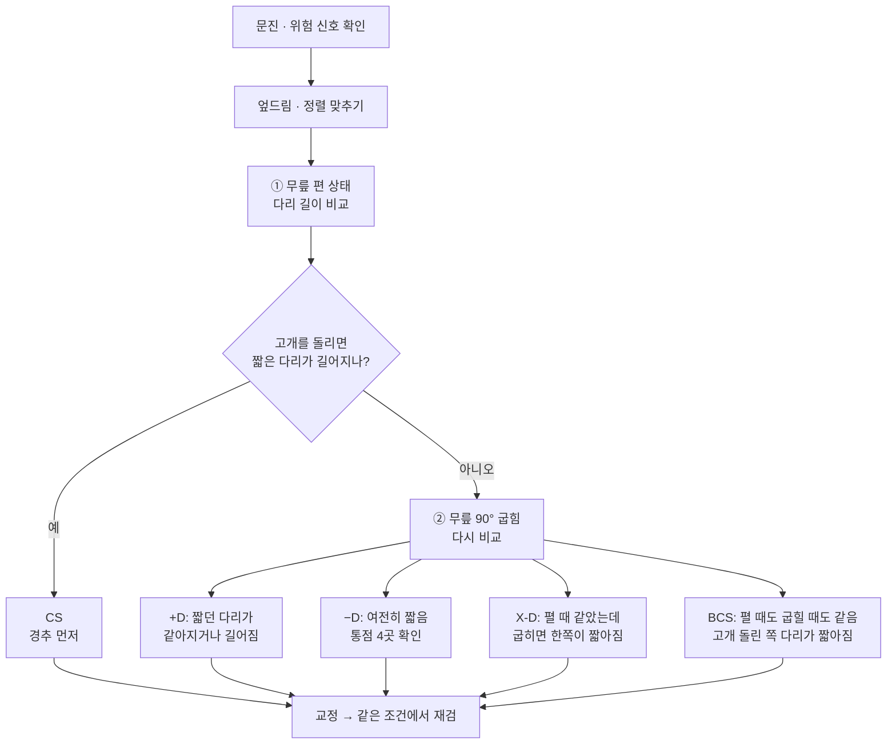
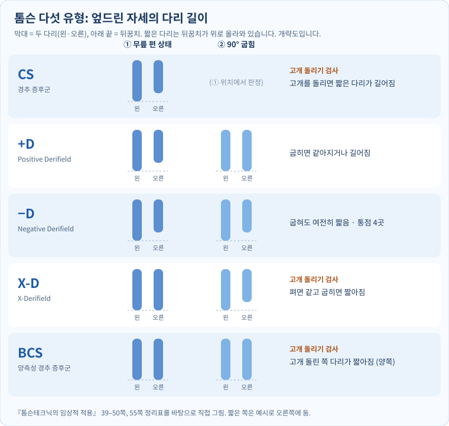

## 1. 강의 개요

4강은 1강에서 본 AK의 네 영역 가운데 **④ 구조**를 다룹니다. 엎드린 사람의 다리 길이를 무릎을 편 상태와 굽힌 상태에서 비교해 다섯 유형으로 나누는 톰슨테크닉을 배우고, 강사가 세운 "골반 PI → 고관절 슬립 → 햄스트링 약화" 가설을 실습했습니다.

| 항목 | 내용 |
| --- | --- |
| 교육과정 | AK 자연치유요법 12주 과정 |
| 회차 | 제4강 (90분) |
| 주제 | 카이로프랙틱 톰슨테크닉 5유형과 골반·햄스트링 스포츠재활 |
| 강사 / 기관 | 비공개 (개인 학습용 정리) |
| 자료 | 학생용 원고 4쪽, 녹취 두 개(실습 시연 약 6분, 설명·실습 약 25분, 자동 인식본이라 불분명한 곳이 많음) |
| 보충 자료 | 『톰슨테크닉의 임상적 적용』(강의에서 "55쪽 톰슨 카테고리"를 보라고 한 책), 『응용근신경학』(AK 교과서), 강사 제공 자연치유요법 교재 「구조 균형 잡기」. 책 쪽수는 인쇄된 쪽 번호입니다 |

**학습목표 (원고):** 다리 길이 관찰의 한계를 이해하고, CS / +D / −D / X-D / BCS를 구분해 평가·교정 판단의 흐름을 설명한다. 골반 기능·햄스트링·달리기 효율에 관한 임상 가설을 객관적 재평가와 연결한다.

- **원고의 성격:** 강의에서 강사는 이 원고를 AI가 정리해 준 것이라고 했고(15:36–15:46), 원고 끝에는 "톰슨테크닉 원문(136쪽 자료)과 대조하지 않은 초안"이라고 적혀 있습니다. 이 노트는 그 책과 대조했습니다(3장 [보충]).
- **녹음 메모:** 실습 중에 교정 동작을 손으로 보여 주는 부분이 많아 녹취만으로는 동작을 알 수 없는 곳이 있습니다. 그런 곳은 적지 않았습니다.

## 2. 전체 흐름

- **톰슨테크닉은 CS부터 봅니다.** 경추 문제로 다리 길이가 달라진 것을 먼저 없애야 골반을 판단할 수 있다는 순서입니다(강의 09:49–09:56, 12:29–12:36, 책 39쪽).
- **강사의 실제 순서:** "결국 경추까지 다 교정해 주니까 순서는 크게 상관없는 것 같다"고 했습니다(13:25–13:45). 원고와 책은 순서를 지키라고 합니다.

## 3. 다섯 유형 — 검사와 판정

**기본 자세 (원고 + 책 41–42쪽):** 엎드린 자세에서 골반·무릎·발목 정렬을 맞추고 양발의 기준점을 같게 합니다. 책은 검사자가 엄지로 양쪽 뒤꿈치를 감싸 잡고, 발이 안팎으로 돌아가거나 발목이 꺾이지 않게 한 뒤 비교하라고 합니다. **① 위치 = 무릎을 편 상태(신전), ② 위치 = 무릎을 90°로 굽힌 상태(굴곡)**이고, 90°를 넘기지 않습니다. 강한 견인·압박은 피합니다(원고).

[그림만 따로 열기](../assets/img/04-thompson5.svg)

| 유형 | 이름 | ① 편 상태 | ② 90° 굽힌 상태 | 고개 돌리기 | 책이 가리키는 곳 |
| --- | --- | --- | --- | --- | --- |
| CS | Cervical Syndrome (경추 증후군) | 한쪽이 짧음 | — | **① 위치에서 고개를 돌리면 짧은 다리가 길어짐**(같아지거나 넘어감) | 경추. 고개를 돌린 쪽의 반대편에서 경결이 만져진다고 함 |
| +D | Positive Derifield | 한쪽이 짧음 | 짧던 다리가 **같아지거나 길어짐**. 굽힐 때 근육이 버티는 느낌 | (CS가 아님을 먼저 확인) | 단족 쪽 장골(PI) |
| −D | Negative Derifield | 한쪽이 짧음 | 굽혀도 **여전히 짧음** | (CS가 아님을 먼저 확인) | 통점 4곳 중 2곳 이상이면 −D. 아니면 5번 허리뼈 회전·요추 후관절 |
| X-D | X-Derifield | **같음** | 한쪽이 **짧아짐** | **② 위치에서** 고개를 돌려 짧은 다리가 길어지면 CS 먼저, 변화 없으면 −D로 다룸 | 대부분 CS나 −D |
| BCS | Bilateral Cervical Syndrome (양측성 경추 증후군) | 같음 | 같음 | **왼쪽으로 돌리면 왼다리, 오른쪽으로 돌리면 오른다리가 짧아짐** | 뒤통수뼈와 1번 목뼈 사이 관절 |

(책: CS 39–42쪽, +D 42쪽, −D 45–46쪽, X-D 48–50쪽, BCS 50쪽, 정리표 55쪽)

**−D의 통점 4곳 (책 45쪽 그림 3-10):** 단족 쪽부터 ① 뒤엉덩뼈가시(PSIS, 엉덩이 위 보조개 자리) ② 궁둥뼈결절(앉을 때 닿는 뼈) ③ 넓적다리뼈 안쪽 위관절융기의 안쪽(무릎 안쪽) ④ 치골결절(두덩뼈 앞)을 누릅니다. **2곳 이상 아프면 −D**로 봅니다. 강의에서도 "통점을 찾아 두고, 교정이 됐으면 다리 길이도 맞고 통점도 사라져야 한다"고 했습니다(10:04–11:21).

**[보충] 원고와 책이 다른 곳 (『톰슨테크닉의 임상적 적용』 기준)**

| 항목 | 원고 | 책 | 정리 |
| --- | --- | --- | --- |
| CS의 판정 | "경추 움직임·증상과 하지 길이 반응의 관련성을 탐색" | 편 상태에서 고개를 돌렸을 때 **짧은 다리가 길어질 때만** CS. 길이가 "변하기만" 하는 것은 CS가 아님(42쪽) | 책 기준으로 판정 |
| +D | 신전에서 단족, 굴곡 시 같아지거나 역전 | 같음 + 굽힐 때 근육 저항이 "턱 걸리는" 느낌 | 같음 |
| −D | 굴곡 시에도 단족으로 남음 | 같음 + **통점 4곳** 판정 | 원고에 없는 통점 판정을 추가 |
| X-D | "교재별 정의 차이: 교차 또는 비전형적 변화" | 편 상태에서 **같고** 굽히면 한쪽이 짧아짐(48쪽). 강의 설명(04:35–04:41)도 같음 | 책·강의 기준으로 정의 |
| BCS | "양측 경추 반응과 하지 길이 패턴을 함께 평가" | 펴도 굽혀도 같고, 고개 돌린 쪽 다리가 **양쪽 다** 짧아짐(50쪽). 강의(06:03–06:28)도 같음 | 책·강의 기준으로 정의 |

**강의에서 덧붙인 것**

- **얼마나 흔한가 (09:13–09:30):** 강사 경험으로는 대부분이 +D이고, −D는 1년에 한두 명, X-D는 1년에 한 명 정도라고 했습니다. 책도 "X-D는 사실 CS거나 −D인 경우가 대부분"이라고 합니다(50쪽).
- **겹쳐 나올 수 있습니다 (12:42–13:21):** +D나 −D이면서 CS가 함께 있을 수 있습니다. 그래서 굽혀도 변화가 없으면 CS를 다시 봅니다.
- **BCS의 교정:** 한쪽씩 돌리지 않고 머리를 끝까지 늘린 상태에서 한 번에 밀어 양쪽을 함께 교정한다고 했습니다(14:00–14:55). 강사는 BCS를 고개 돌리기 대신 **근육검사(AK)로 바로 찾는다**고 했습니다(07:08–07:10). 이 검사는 책의 방법이 아닙니다.
- **5유형을 먼저 익히고**, 흉추·갈비뼈 회전·어깨뼈·목 위쪽 관절 안정화 같은 추가 교정은 그다음이라고 했습니다(07:20–08:47).

## 4. 실습 절차 — 평가, 교정 판단, 재평가

**원고의 공통 평가 원칙**

- **문진:** 통증 위치·기간, 외상, 골다공증, 골절, 수술력, 신경학적 증상, 운동 종목과 훈련량.
- **위험 신호 → 교정하지 않고 의료 평가부터:** 점점 심해지는 근력 저하·감각 장애, 대소변 장애, 심한 외상, 감염·종양 의심, 목 혈관 관련 증상.
- **반복성:** 2~3회 재검, 관찰자 간 차이, 고관절 회전·근긴장·발목 자세의 영향을 기록.
- **교정 판단:** 통증·기능·가동범위·근력 같은 **독립 지표를 종합**한다. 실제 드롭 교정은 **전문 교육·감독 아래에서만**.
- **공통 교정 흐름(다섯 유형 모두 같음):** 적응증·금기 확인 → 통증 없는 자세 → 교정 부위·방향을 다른 기능검사와 원서 기준으로 교차 확인 → 자격 있는 지도자 감독 아래 시행 → 즉시 재검. 원고는 접촉점·방향·드롭 높이를 **일부러 적지 않았습니다.** 이 노트도 교정 동작은 적지 않습니다.

**강의 시연에서 본 것**

- 교정 뒤 다리 길이가 "거의 같아졌다"를 확인하고, 발목이 굳은 사람은 **발목 교정을 따로** 했습니다(녹음 1, 00:40–01:25).
- 의자에 앉혀 몸통이 틀어진 쪽을 보고 몸통을 돌리며 교정하는 동작도 보여 주었습니다(녹음 1, 04:44–04:58).
- 교정한 사람이 효과를 느끼게 하려고 **교정 전후에 슬립과 햄스트링 저항을 직접 느끼게 해 준다**고 했습니다(23:06–23:57).

**실습 기록지 (원고 6장)** — 교정 전·후를 같은 칸에 적습니다.

| 항목 | 교정 전 | 교정 후 |
| --- | --- | --- |
| 통증 (0–10) | | |
| 편 상태의 단족 | | |
| 굽힐 때 변화 | | |
| 고관절 가동범위 | | |
| 햄스트링 저항 좌/우 | | |
| 달리기·보행 관찰 | | |

실습자, 피검사자, **검사 반복 횟수**, 특이사항도 함께 적습니다. 기록을 맹검으로 남기는 방법은 8장에 있습니다.

## 5. 골반 PI 가설, 고관절 슬립, 햄스트링

### 강사의 가설 (15:36–17:36, 19:28–20:24)

1. 단족 쪽(+D) 장골이 **PI(뒤아래쪽)로 돌아갑니다.** PI는 뒤엉덩뼈가시(PSIS)가 뒤아래로 옮겨진 상태입니다(책 24쪽).
2. 그러면 고관절에서 **슬립**이 생깁니다. 다리를 편 채 발바닥 쪽에서 머리 쪽으로 살짝 밀면, 정상 쪽은 "딱 붙어" 있는데 PI 쪽은 밀리는 느낌이 난다고 했습니다.
3. 달리기는 바닥을 밀며 차고 나가는 동작이라, 슬립이 있으면 **반발력이 떨어진다**는 설명입니다. 선수 본인은 느끼지 못한다고 했습니다.
4. 슬립이 있는 쪽은 **햄스트링 저항검사에서 버티지 못한다**고 했습니다. 단거리 선수가 순간 스퍼트에서 햄스트링이 파열되는 것도 이런 경우가 많다는 견해입니다.
5. 시연: 교정 뒤 슬립이 없어지고 햄스트링에 "힘이 딱 들어온다"고 했습니다(21:39–22:13).

**햄스트링 저항검사 (원고 5장, 강의 19:41–21:20):** 엎드림 → 무릎을 약 45° 굽힘 → 검사자가 발목·뒤꿈치에 무릎을 펴는 방향으로 **점점** 힘을 줌 → 피검사자는 굽힌 자세를 유지 → 좌우의 힘·통증·보상 움직임을 기록합니다. 강의에서는 "하나, 둘, 셋" 하고 누른다고 했습니다. **검사 힘과 손 위치(지렛대 길이)를 매번 같게** 합니다(원고).

### 원고가 붙인 선 (원고 4·5장)

- 슬립 관찰은 "기존 임상 아이디어"이고 **구조적 변위를 확진하는 방법이 아니다.** 통증을 일으키는 강한 압박은 피하고, 재현성이 검증되기 전에는 슬립이나 탈구의 객관적 증거로 기록하지 않는다.
- 다리 길이 차이는 실제 뼈 길이 차이, 고관절 회전, 근긴장, 검사 자세, 관찰 오차에서도 생긴다. 고관절의 실제 아탈구·불안정은 의학적 평가가 필요하다.
- 햄스트링은 고관절 신전, 무릎 굴곡, 스프린트 말기 다리 감속에 관여한다. 그러나 **"PI 교정 → 슬립 해소 → 햄스트링 100% 회복 → 기록 향상"이라는 연쇄 인과는 검증되지 않았다.** 근력·통증·ROM·달리기 영상·기록을 함께 확인한다.

**[보충] 책과 맞춰 보면**

- **PI와 햄스트링의 방향이 책과 반대입니다.** 『톰슨테크닉의 임상적 적용』 46쪽은 반막양근·반건양근(안쪽 햄스트링)의 긴장이 커지면 궁둥뼈를 앞아래로 끌어 **장골이 PI로 돌아간다**고 적습니다. 햄스트링 긴장이 원인, PI가 결과입니다. 강의는 PI 때문에 햄스트링이 약해진다고 했습니다. 42쪽은 +D 장골 교정 뒤에도 +D가 남으면 엉덩허리근과 이 두 햄스트링을 함께 다루라고 합니다. 어느 쪽이든 PI와 햄스트링이 이어져 있다는 점은 같지만, 원인과 결과의 방향은 다르게 설명합니다.
- **"슬립"이라는 말과 검사는 책에서 찾지 못했습니다**(본문 글자 검색). 원고 말대로 강사의 임상 아이디어로 봅니다.
- **『응용근신경학』 3장 「1형 골반변형」(162–163쪽):** 짧은 다리 쪽에서 뒤엉덩뼈가시가 뒤로 밀려 있을 때 유발검사가 양성으로 나온다고 해, 단족 쪽 장골이 뒤로 간다는 점은 같습니다. 다만 이 책은 **"유발검사 결과와 다리 길이 차이가 일치하지 않으면 유발검사를 우선한다"**고 하고, 실제 뼈 길이 차이나 신경계 부조화(2강 3장)도 따져야 한다고 적습니다. 다리 길이 하나로 판단하지 말라는 원고와 같은 방향입니다.
- **IN·EX (책 65쪽):** 원고의 "PI(후하방·외측)"에서 "외측"은 책에서는 PI와 따로 보는 **EX(장골이 천골에서 멀어짐)**입니다. 책은 보통 PI·AS와 IN·EX가 함께 온다고 합니다.

## 6. 전체 흐름과 연결

- **1강 4대 영역:** 에너지 → 정신 → 화학 → **구조**. 4강은 구조의 첫 회차입니다. 강사 제공 자연치유요법 교재 「구조 균형 잡기」는 척추의 구조 문제가 신경 → 내부 장기 → 근육 약화 → 구조 붕괴로 이어지는 악순환을 설명합니다.
- **강사의 "양날개" 설명 (18:04–19:25):** 질문에 답하며, 교정만으로는 오래 유지되기 어렵고(오전에 교정해도 2시간쯤 지나면 다시 틀어진다고 함), 근육은 경락 같은 "보이지 않는 에너지"의 지배를 받으므로 **보이지 않는 부분(에너지·정신·화학)과 보이는 부분(구조 교정·테이핑)을 함께** 다뤄야 효과가 커진다고 했습니다. 이것이 AK 자연치유요법의 기본 구조라는 설명입니다.
- **근육검사와의 연결:** 햄스트링 저항검사는 1강의 근육반응검사와 같은 원리(일정한 자세·방향·압력)로 합니다. 1강의 원칙과 8장의 맹검 방법을 그대로 적용하면 됩니다.
- **2강 Switch On과 『응용근신경학』의 신경계 부조화:** 이 책은 신경계 부조화가 있으면 다리 길이·근육검사 결과가 예측대로 나오지 않는다고 하므로, 다리 검사 전에도 Switch On을 하는 것이 앞뒤가 맞습니다(2강 3장 [보충]).

## 7. 원고에 없던 강의 내용

| 시각 | 내용 |
| --- | --- |
| 00:14–01:28 | 다섯 유형 이름 소개. CS는 경추가 한쪽으로 틀어지며 다리 길이에 영향을 주는 것, BCS는 양쪽 경추가 함께 영향을 주는 것 |
| 07:08–07:10 | BCS를 고개 돌리기 대신 근육검사(AK)로 찾는다 |
| 07:20–08:47 | 흉추·갈비뼈 회전·어깨뼈 교정, 목 위쪽 관절 안정화 등 추가 기법은 5유형을 익힌 뒤 |
| 09:13–09:30 | 대부분 +D, −D·X-D는 1년에 한두 명 |
| 09:34–09:41 | 책 55쪽 톰슨 카테고리 표만 이해하면 되고 나머지는 읽어 보면 된다 |
| 10:04–11:21 | 통점을 찾아 두고, 교정 후 통점도 사라졌는지 확인 |
| 13:25–13:45 | 실제로는 경추까지 다 교정하므로 순서는 크게 상관없다는 강사의 루틴 |
| 15:21–15:33, 24:39 | 액티베이터 관련 책을 찾아 다음에 주겠다고 함 |
| 15:36–15:46 | 원고는 AI가 정리했고, PI 가설을 강사가 강조해서 들어갔다는 설명 |
| 18:04–19:25 | 교정은 오래 유지되기 어렵다(2시간쯤 지나면 다시 틀어짐), 보이는 부분과 보이지 않는 부분을 함께 다루는 "양날개" |
| 22:16–22:25 | 단거리 선수에게 골반 교정이 매우 중요하다는 주장 |
| 녹음 1 03:32–03:53 | BCS의 다리 검사는 하지 않고 다른 검사와 일자목 여부로 본다고 함(녹음이 불분명) |

## 8. 비판적 검토 — 근거 수준과 주의점 {: .critical }

결론부터: **원고는 스스로 "다리 길이만으로 확정하지 말고 독립 지표로 재평가하라"는 선을 그었고, 그 선은 타당합니다.** 검사의 신뢰도를 직접 잰 연구를 보면, 엎드린 다리 길이 검사에서 믿을 만한 것은 "어느 쪽이 짧은가"까지이고, 고개 돌리기 검사는 우연과 다르지 않았습니다.

**1. 다리 길이 검사의 신뢰도.** 허리 통증 환자 45명을 두 검사자가 따로 본 연구(2007)에서, 엎드린 자세의 짧은 쪽 판정은 일치도가 좋았지만(κ = 0.65) 차이의 크기는 낮았고(κ = 0.28), **고개를 돌리는 검사는 κ ≈ 0.04로 우연 수준**이었습니다. 무릎 90° 굽힘 검사는 일치도를 계산할 수 없었습니다. 이 연구는 신뢰도만 봤고, 다리 길이 검사가 실제 골반 상태를 맞히는지(타당도)는 확인되지 않았습니다([Dynamic Chiropractic 해설, 2009](https://dynamicchiropractic.com/article/53607-reliability-and-validity-of-the-prone-leg-check), 원 논문 J Manipulative Physiol Ther 2007;30(7):514–21). **CS·X-D·BCS는 모두 고개 돌리기에 기대므로, 다섯 유형 가운데 가장 흔들리는 부분이 판정의 출발점입니다.**

**2. "교정했더니 같아졌다"는 같은 검사자가 결과를 알고 다시 본 것입니다.** 차이의 크기는 눈대중 신뢰도가 낮은 영역이라, 기대가 판정에 들어가기 쉽습니다. 햄스트링 저항검사도 같은 사람이 "이제 힘이 들어온다"를 기대하며 누릅니다. 1강에서 본 근육검사의 맹검 결과(우연 수준)가 여기에도 그대로 해당합니다.

**3. "교정 전후를 느끼게 해 준다"는 확인이 아니라 설득입니다.** 피검사자가 교정 전 슬립·약함을 "느끼게" 한 뒤 교정 후 나아진 것을 느끼게 하는 방법은 기대 효과를 가장 크게 만드는 순서입니다. 효과를 확인하려면 피검사자와 검사자 모두 교정 여부를 모르게 해야 합니다.

**4. 강사 스스로 말한 한계.** "교정해도 2시간쯤 지나면 다시 틀어진다"는 말은 다리 길이 변화가 교정 효과라기보다 **자세·근긴장에 따라 수시로 바뀌는 값**일 수 있다는 뜻으로도 읽힙니다. 오래 가지 않는 변화를 근거로 달리기 기록 향상을 설명하기는 어렵습니다.

**5. 가설의 연결 고리는 하나도 따로 확인되지 않았습니다.** PI → 슬립 → 햄스트링 약화 → 반발력 저하 → 기록, 그리고 햄스트링 파열과의 관계는 원고 스스로 "검증되지 않았다"고 했습니다. 책은 인과 방향을 반대로 설명합니다(5장 [보충]). 햄스트링 부상의 위험 요인은 스포츠의학에서 따로 연구되는 주제이므로, 선수에게 적용한다면 이 가설이 아니라 그 연구를 기준으로 해야 합니다.

**6. 안전과 자격.** 원고는 드롭 교정을 "전문 교육·감독 아래에서만", 목 고속 교정은 "별도 전문 평가·자격 필수"라고 했습니다. 목의 고속 교정은 드물지만 목 혈관 손상과 연관된 보고가 있어 위험 신호 선별이 중요하다는 것이 일반적인 견해입니다. 교정은 의료 행위와 겹칠 수 있어 하는 곳의 법을 먼저 확인하는 것이 안전합니다.

**합리적인 것:** 위험 신호 선별, 같은 조건 반복(2~3회)과 관찰자 간 차이 기록, 다리 길이가 다른 이유(뼈 길이·근긴장·자세·오차)를 먼저 생각하기, 통증·가동범위·근력 같은 **독립 지표**로 전후를 비교하기. 원고의 이 원칙들은 그대로 쓰면 됩니다.

**맹검으로 해 보는 방법 (제안):** 검사자 A가 다리 길이·햄스트링을 기록하고 자리를 비움 → B가 교정하거나 교정하는 척만 함(동전으로 정하고 기록은 봉투에) → A가 다시 기록 → 10명쯤 모은 뒤 봉투를 열어 비교. 기록지의 "검사 반복 횟수" 칸에 A·B를 함께 적어 두세요.

## 9. 꼭 기억할 5가지 · 확인할 것

**오늘의 핵심 한 문장:** "엎드려 무릎을 폈을 때와 굽혔을 때 짧은 다리가 어떻게 변하는지로 다섯 유형을 가르되, 다리 길이 하나로 확정하지 말고 같은 조건의 독립 지표로 재평가한다."

**꼭 기억할 5가지**

1. 검사 위치는 ① 무릎을 편 상태, ② 무릎 90° 굽힘. 굽혔을 때 짧던 다리가 같아지거나 길어지면 +D, 그대로 짧으면 −D.
2. CS를 먼저 본다. 편 상태에서 고개를 돌려 짧은 다리가 **길어질 때만** CS.
3. X-D는 펼 때 같고 굽히면 짧아짐, BCS는 펴도 굽혀도 같고 고개 돌린 쪽 다리가 양쪽 다 짧아짐.
4. −D는 통점 4곳(PSIS, 궁둥뼈결절, 무릎 안쪽, 치골결절) 중 2곳 이상.
5. 슬립·PI·햄스트링 연쇄는 강사의 가설이다. 교정 전후는 통증·가동범위·근력을 같은 조건에서 기록하고, 교정 동작은 자격 있는 지도자 감독 아래서만.

**확인문제 요점 (원고 7장):** +D와 −D는 굽힌 상태의 변화로 가른다(3장 표). 다리 길이만으로 PI를 확정할 수 없는 이유는 뼈 길이·고관절 회전·근긴장·자세·관찰 오차로도 차이가 나기 때문(5장). 경추 증상이나 신경학적 위험 신호가 있으면 교정 전에 의료 평가(4장). 햄스트링 저항검사에서 통제할 것은 무릎 각도(약 45°), 검사 힘, 손 위치(지렛대). 교정 "효과"를 말하려면 통증·가동범위·기능검사·좌우 근력 같은 독립 지표가 같은 조건에서 바뀌어야 한다.

**강사께 확인할 것**

1. BCS를 근육검사로 찾는 방법의 절차(어디에 손을 대고 무엇을 묻는지).
2. 슬립 관찰에서 미는 힘의 크기와 방향, 한쪽에 몇 번 보는지.
3. PI와 햄스트링의 인과 방향: 강의(PI 때문에 햄스트링 약화)와 책 46쪽(햄스트링 긴장 때문에 PI)이 다른 이유.
4. 교정 뒤 다시 틀어질 때(2시간쯤) 재교정 간격이나 기준.
5. 액티베이터 책(2강에서부터 남은 액티베이터 제조사 질문과 함께).

**다음 시간까지:** 두 사람이 짝을 지어 ① 편 상태 단족 판정 ② 굽힌 상태 변화를 **서로 결과를 모른 채** 각각 기록하고 일치하는지 비교해 보기. 교정 동작은 연습하지 않고 평가만 연습.
